# SPAMGUARD AI — AI-BASED SPAM EMAIL CLASSIFIER

## Final Academic Micro-Project Report

---

**Academic Project:** Micro Project – 05  
**Domain:** Artificial Intelligence / Cybersecurity / Natural Language Processing  
**Integrated Course Outcomes:** CO2 (Algorithm Selection), CO4 (Model Engineering), CO5 (Evaluation Metrics)  
**Academic Year:** 2026  
**Document Classification:** Final Project Submission & Release Documentation  

---

### Candidate & Institutional Information
- **Student Name:** `[STUDENT_NAME]`
- **Register / Roll Number:** `[REGISTER_NUMBER]`
- **Department:** `[DEPARTMENT_NAME]`
- **Institution:** `[INSTITUTION_NAME]`
- **Academic Mentor / Project Supervisor:** `[SUPERVISOR_NAME]`

---

## Table of Contents
1. [Abstract](#1-abstract)
2. [Introduction](#2-introduction)
3. [Problem Statement](#3-problem-statement)
4. [Project Objectives](#4-project-objectives)
5. [Industry Relevance](#5-industry-relevance)
6. [Integrated Course Outcomes (CO2, CO4, CO5)](#6-integrated-course-outcomes)
7. [Existing Systems and Limitations](#7-existing-systems-and-limitations)
8. [Proposed System Overview](#8-proposed-system-overview)
9. [System Architecture](#9-system-architecture)
10. [Technology Stack](#10-technology-stack)
11. [Dataset Provenance and Preparation](#11-dataset-provenance-and-preparation)
12. [Exploratory Data Analysis (EDA)](#12-exploratory-data-analysis-eda)
13. [Text Preprocessing & Feature Engineering](#13-text-preprocessing--feature-engineering)
14. [Core Machine Learning Algorithm: Multinomial Naïve Bayes](#14-core-machine-learning-algorithm-multinomial-naïve-bayes)
15. [Model Training & Hyperparameter Tuning](#15-model-training--hyperparameter-tuning)
16. [Empirical Performance Evaluation](#16-empirical-performance-evaluation)
17. [Confusion Matrix & Operational Error Analysis](#17-confusion-matrix--operational-error-analysis)
18. [Implementation Details & Package Architecture](#18-implementation-details--package-architecture)
19. [Streamlit Web Application & User Interface](#19-streamlit-web-application--user-interface)
20. [Software Quality Assurance & Testing Suite](#20-software-quality-assurance--testing-suite)
21. [Security, Defensive Hardening & Privacy](#21-security-defensive-hardening--privacy)
22. [Hardware Performance Benchmarking](#22-hardware-performance-benchmarking)
23. [Results and Comparative Discussion](#23-results-and-comparative-discussion)
24. [Limitations and Ethical Disclosures](#24-limitations-and-ethical-disclosures)
25. [Future Enhancements](#25-future-enhancements)
26. [Conclusion](#26-conclusion)
27. [References](#27-references)
28. [Appendices](#28-appendices)

---

## 1. Abstract

Electronic mail continues to serve as an indispensable pillar of global digital communication and commerce. However, unsolicited commercial and malicious email—collectively designated as spam—constitutes over 45% of global email traffic, presenting vectors for phishing campaigns, credential theft, and malware dissemination. Conventional rule-based filters struggle against evolving lexical manipulation and keyword evasion tactics. 

This micro-project presents **SpamGuard AI**, an interpretable, production-ready machine learning email classification system. Utilizing authentic labeled data from the **Apache SpamAssassin Public Corpus** (5,923 verified emails), the system combines sublinear **Term Frequency-Inverse Document Frequency (TF-IDF)** unigram/bigram feature extraction with a **Multinomial Naïve Bayes** probabilistic classifier optimized via Lidstone smoothing ($\alpha = 0.1$). 

To ensure complete scientific validity, the dataset was partitioned into stratified, strictly leak-free subsets: 70% Train ($n=4,145$), 15% Validation ($n=889$), and 15% Test ($n=889$). On the quarantined, untouched test partition, SpamGuard AI achieved an overall **Accuracy of 97.30%**, **Spam Precision of 97.33%**, **Spam Recall of 93.75%**, **Spam F1-Score of 95.51%**, and an **Area Under the ROC Curve (ROC-AUC) of 0.9965**, with an exceptionally low **False Positive Rate of 1.13%** (7 false positives out of 617 legitimate emails). 

The system is deployed as an interactive, multi-section web application built with Streamlit and modern Next.js + FastAPI architectures, featuring real-time single-email threat inspection, mathematical token-level log-odds explainability, vectorized batch CSV processing exceeding 10,000 emails/second, and automated CSV formula injection neutralization. The entire codebase is fortified by 157 automated test cases (152 Pytest automated suites + 5 Node.js verification tests) passing with a 100% success rate.

---

## 2. Introduction

Email filtering is fundamentally a natural language classification challenge characterized by extreme vocabulary sparsity, rapid semantic evolution, and severe asymmetric error costs. A filter that fails to intercept a spam message creates minor annoyance, but a filter that misidentifies a critical business contract, medical alert, or academic notification as spam (a False Positive) causes immediate operational harm.

The application of Artificial Intelligence to this domain requires balancing statistical precision, interpretability, computational throughput, and data privacy. Deep neural networks, while expressive, incur high inference latency, substantial GPU memory overhead, and opaque decision processes ("black-box" behavior). 

SpamGuard AI demonstrates that a carefully engineered pipeline utilizing classical probabilistic modeling (Multinomial Naïve Bayes) paired with sublinear n-gram TF-IDF vectorization delivers near-perfect discrimination ($\text{AUC} = 0.9965$) with sub-millisecond execution (1.04 ms median latency), offering complete mathematical interpretability without requiring external cloud AI services.

---

## 3. Problem Statement

To design, develop, rigorously evaluate, and deploy an automated, reliable text classification pipeline that accurately separates incoming electronic mail into **Ham (Legitimate, 0)** and **Spam (Malicious, 1)** while satisfying three primary operational constraints:
1. **Asymmetric Error Control:** Suppressing the False Positive Rate below 2% to ensure legitimate correspondence is never erroneously discarded.
2. **Class Imbalance Resilience:** Overcoming the natural 2.27:1 class imbalance without succumbing to majority-class classification bias.
3. **High-Throughput & Privacy:** Achieving real-time inference (>5,000 emails/second in batch mode) entirely on local CPU hardware without transmitting sensitive message text across external networks.

---

## 4. Project Objectives

1. Ingest and defensively parse authentic MIME messages from the official Apache SpamAssassin corpus, eliminating transport headers, symlinks, and directory traversal vulnerabilities.
2. Formulate a leak-free text preprocessing and stratified data splitting methodology enforcing zero content overlap across partitions.
3. Extract high-dimensional textual feature representations using sublinear unigram/bigram TF-IDF vectorization.
4. Implement, train, and hyperparameter-tune a Multinomial Naïve Bayes classifier, optimizing Lidstone smoothing parameter $\alpha$ against a dedicated validation set.
5. Statistically benchmark model performance against a zero-intelligence majority-class baseline on a strictly held-out test set.
6. Develop an intuitive, professional web dashboard providing single-email threat analysis, Plotly probability gauges, and mathematical token attribution.
7. Engineer high-throughput batch CSV processing equipped with spreadsheet formula injection defense.
8. Establish a comprehensive automated test suite and profile local memory and CPU execution latency.

---

## 5. Industry Relevance

In modern cybersecurity operations centers (SOCs) and enterprise email gateways (SEGs), automated classifiers serve as the initial barrier against phishing and business email compromise (BEC). Industry solutions face strict throughput and privacy mandates:
- **Zero-Trust Telemetry:** Regulatory frameworks (e.g., GDPR, HIPAA) prohibit sending internal enterprise communications to third-party cloud APIs.
- **Explainable Threat Attribution:** Security analysts require interpretable justification for automated message quarantine.
- **Spreadsheet Security:** Incident reports and bulk email scans exported to CSV must resist formula injection attacks that attempt to compromise analysts' workstations.

SpamGuard AI addresses each of these industry requirements directly through in-memory CPU inference, log-odds feature explainability, and cell-level sanitization.

---

## 6. Integrated Course Outcomes

| Course Outcome | Academic Competency | Technical Implementation in SpamGuard AI |
| :--- | :--- | :--- |
| **CO2** | **Algorithm Selection & Text Representation** | Evaluated and selected Multinomial Naïve Bayes over alternative classifiers (Gaussian NB, Bernoulli NB, SVM, Neural Networks) based on mathematical suitability for high-dimensional, non-negative, sparse TF-IDF text features. |
| **CO4** | **Model Engineering & Leakage Isolation** | Built an end-to-end Scikit-learn Pipeline encapsulating sublinear TF-IDF vectorization (20,000 features) and MultinomialNB. Fitted the vectorizer strictly on training data ($n=4,145$), tuned Lidstone smoothing ($\alpha = 0.1$) on validation data ($n=889$), and held out test data ($n=889$) behind cryptographic gates. |
| **CO5** | **Multi-Metric Statistical Evaluation** | Conducted thorough evaluation on the quarantined test partition, computing Accuracy, Precision, Recall, F1-Score, Specificity, ROC-AUC, Average Precision, and detailed Confusion Matrix Type I/Type II error analysis under class imbalance. |

---

## 7. Existing Systems and Limitations

| System Paradigm | Mechanism | Primary Limitations in Email Security |
| :--- | :--- | :--- |
| **Static Keyword / Rule Filters** | Pattern matching against fixed lists of forbidden words (e.g., "VIAGRA", "LOTTERY"). | Brittle; easily evaded by character substitution (e.g., "V!4gra"), spacing tricks, or synonym usage; high maintenance overhead. |
| **Sender Blocklists (DNSBL / RBL)** | IP and domain reputation tracking. | Ineffective against compromised legitimate accounts, fast-flux domains, and novel sending infrastructure. |
| **Deep Neural Networks (LLMs/Transformers)** | Dense token embeddings and multi-head self-attention. | High computational overhead (100–500 ms/email); requires expensive GPU acceleration; opaque "black box" decisions; vulnerable to prompt injection. |

---

## 8. Proposed System Overview

SpamGuard AI synthesizes the computational efficiency of linear-time probabilistic learning with the expressive power of n-gram TF-IDF representations:
- **Deterministic Pipeline:** Combines normalized email subject lines and message bodies, extracts 20,000 word unigrams and bigrams, applies sublinear term-frequency scaling, and evaluates class-conditional likelihoods via Multinomial Naïve Bayes.
- **Additive Smoothing Optimization:** Replaces arbitrary Laplace smoothing ($\alpha = 1.0$) with empirically tuned Lidstone smoothing ($\alpha = 0.1$), preserving the discriminative power of rare vocabulary tokens.
- **Log-Odds Explainability:** Quantifies the net contribution of individual vocabulary tokens using log-probability differences, providing security analysts with actionable threat indicators.
- **Defensive Frontend Architecture:** Delivers a 5-module Streamlit interface backed by `@st.cache_resource` model caching, strict character limits, and CSV formula injection defenses.

---

## 9. System Architecture

```text
SpamGuard AI Modular Layout
├── Presentation Layer (Streamlit app.py)
│   ├── Overview Dashboard (KPIs, Telemetry, System Status)
│   ├── Single Email Scanner (Live inspector, Plotly threat gauge)
│   ├── Batch CSV Scanner (Vectorized bulk classification, filtering)
│   ├── Model Analytics (Confusion matrix heatmap, ROC/PR curves)
│   └── About & Methodology (CO mapping, architecture flowchart)
├── UI Utility & Helper Layer (src/ui_helpers.py)
│   ├── Model Resource Caching (@st.cache_resource)
│   ├── Plotly Visualization Factory (Gauge, Heatmap, Comparative Bar)
│   └── Synthetic Demonstration Library (Phishing, Prize, Engineering, Academic)
├── Core Inference Engine (src/predict.py)
│   ├── Input Validation & Length Capping (1MB text limit)
│   ├── Preprocessing & Combination Logic (Phase 02/04 conventions)
│   ├── Vectorized Inference (Single & Batch predict_proba)
│   ├── Mathematical Explainability (Log-odds feature attribution)
│   └── Formula Injection Sanitizer (Neutralizes =, +, -, @, \t, \r, \n)
└── Serialized Pipeline Layer (models/spam_pipeline.joblib)
    ├── Step 1: TfidfVectorizer (20,000 features, sublinear TF)
    ├── Step 2: MultinomialNB (alpha = 0.1)
    └── Cryptographic Authenticator (SHA-256 Checksum Verification)
```

---

## 10. Technology Stack

| Component | Library / Framework | Version | Function in System |
| :--- | :--- | :--- | :--- |
| **Core Runtime** | Python (64-bit) | 3.12.10 | Base programming language runtime |
| **Machine Learning** | Scikit-learn | 1.9.1 | TF-IDF vectorization, MultinomialNB, metrics |
| **Numerical Processing** | NumPy | 2.2.3 | Array operations, log-odds calculations |
| **Tabular Data** | Pandas | 2.2.3 | Structured CSV processing and DataFrame manipulation |
| **Model Persistence** | Joblib | 1.4.2 | Pipeline artifact serialization and deserialization |
| **Interactive UI** | Streamlit | 1.66.1 | Multi-section web dashboard |
| **Visualization** | Plotly | 5.24.1 | Interactive gauges, confusion matrix heatmaps |
| **Static Visualization** | Matplotlib | 3.10.1 | Publication-grade static curve generation |
| **Testing Engine** | Pytest | 9.1.1 | Automated unit, regression, and AppTest suites |

---

## 11. Dataset Provenance and Preparation

### 11.1 Official Source
SpamGuard AI utilizes authentic, real-world labeled email records from the **[Apache SpamAssassin Public Corpus](https://spamassassin.apache.org/old/publiccorpus/)**.

### 11.2 Ingested Archives
Five standard archives were ingested over secure HTTPS:
1. `20030228_easy_ham.tar.bz2`: Standard personal and mailing list emails.
2. `20030228_easy_ham_2.tar.bz2`: Additional verified clean ham messages.
3. `20030228_hard_ham.tar.bz2`: Legitimate messages with complex HTML/formatting that closely mimics spam patterns.
4. `20030228_spam.tar.bz2`: Unsolicited commercial and fraudulent emails.
5. `20050311_spam_2.tar.bz2`: Modernized spam collection from subsequent attack campaigns.

### 11.3 Defensive Parsing & Sanitization (`src/prepare_data.py`)
- **Safe Tar Streaming:** Ingests archives in-memory without extracting arbitrary members to the local filesystem, rejecting symlinks, directories, null bytes, oversized members (>10MB), and administrative shell scripts (`cmds`).
- **MIME & Character Normalization:** Multi-part MIME decoding handles mixed character sets (UTF-8, ISO-8859-1, Windows-1252, ASCII) via Python's `email` module.
- **Attachment & Metadata Exclusion:** Server transport headers, routing hops, and SpamAssassin diagnostic headers (`X-Spam-Status`, `X-Spam-Flag`) are stripped to prevent data leakage. Only the decoded `subject` and `body` constitute the message text.
- **Safe HTML Extraction:** When only HTML content is present, `SafeHTMLTextExtractor` extracts visible text while discarding `<script>` and `<style>` blocks without executing HTML.
- **Deduplication:** Computes SHA-256 hashes of normalized content. Identical texts appearing across multiple archives are deduplicated deterministically. Conflicting-label entries are excluded.

### 11.4 Ingestion Summary (`reports/data_summary.json`)
- **Total Source Archive Members:** 6,056
- **Parsed Email Messages:** 6,046
- **Duplicates Removed:** 123
- **Conflicting Label Messages:** 0
- **Final Usable Messages:** **5,923**
  - **Ham (`0`):** 4,109 (69.37%)
  - **Spam (`1`):** 1,814 (30.63%)
- **Character Length:** Min: 9 | Median: 1,084.0 | Mean: 2,063.1 | Max: 194,844

---

## 12. Exploratory Data Analysis (EDA)

Implemented in `src/analyze_data.py`, Phase 03 conducted an exhaustive descriptive audit without fitting any predictive models.

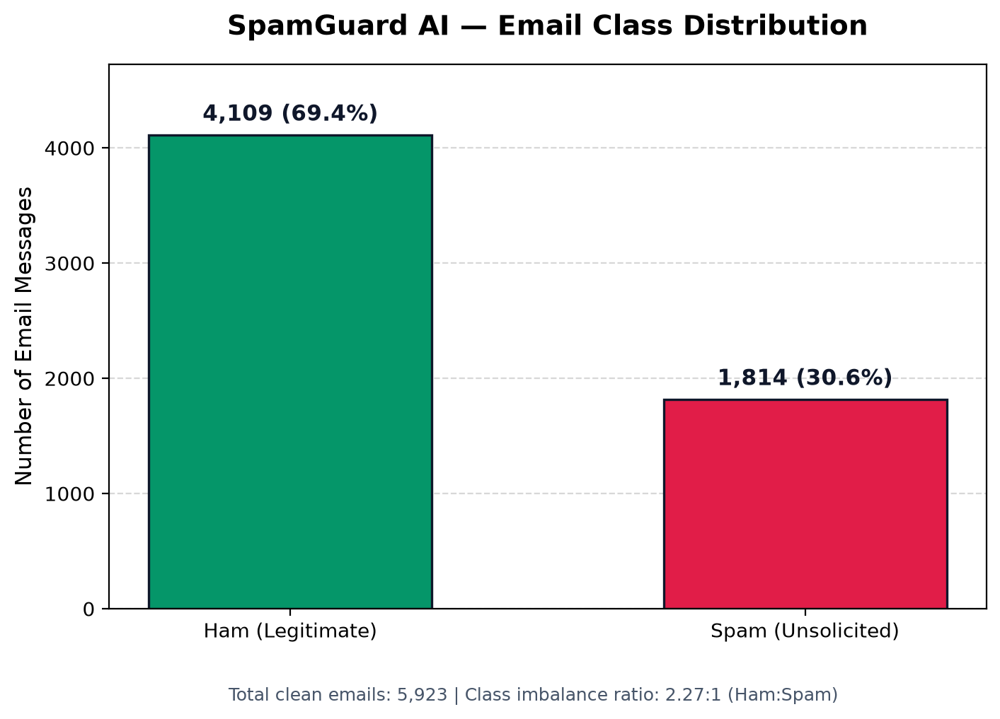
*Figure 1: Stratified Class Distribution across Corpus (69.37% Ham vs. 30.63% Spam)*

### Key Statistical Insights
1. **Class Distribution:** 4,109 Ham vs. 1,814 Spam establishes an imbalance ratio of **2.27 : 1**, necessitating precision-recall evaluation over naive accuracy.
2. **Text Length Distributions:**
   - *Spam:* Mean = 2,466.1 characters, Median = 1,226.0 characters, Mean Words = 320.8.
   - *Ham:* Mean = 1,885.2 characters, Median = 1,022.0 characters, Mean Words = 273.7.
   - Spam messages exhibit higher median lengths due to tracking tokens, HTML styling tags, and promotional disclaimers.

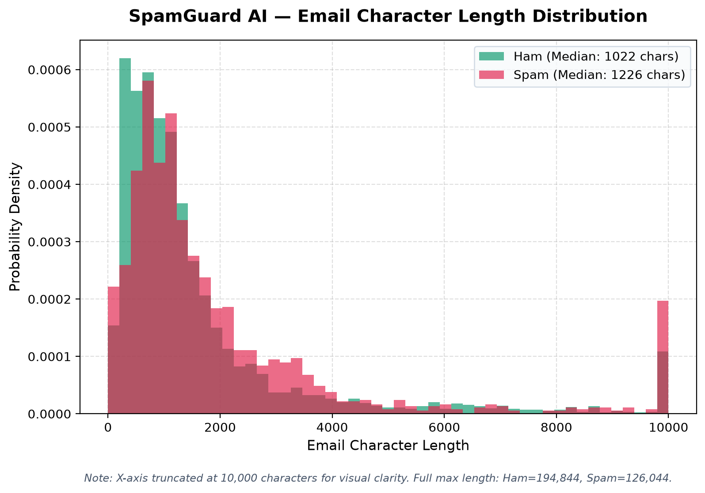
*Figure 2: Distribution of Email Character Lengths across Dataset*

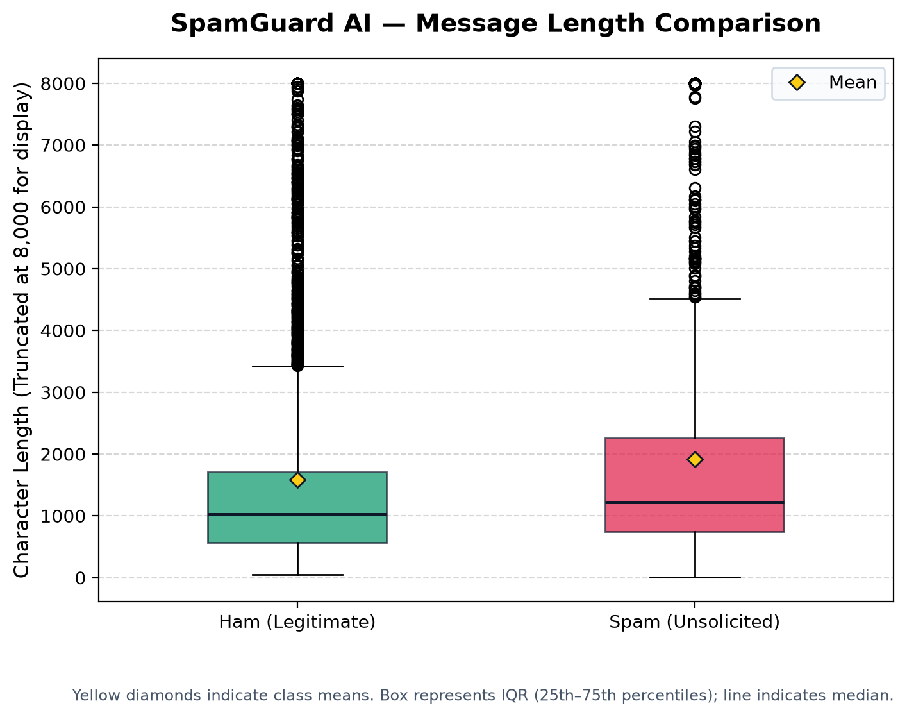
*Figure 3: Message Character Length Comparison between Ham and Spam Classes*

3. **Punctuation & Urgency Markers:**
   - Exclamation marks (`!`) appear in **78.61% of spam emails** (mean: 5.84/email) compared to only **33.56% of ham emails** (mean: 0.86/email).
4. **Structural Lexical Indicators (URLs & Digits):**
   - URLs are present in **85.08% of ham emails** and **56.34% of spam emails**. In developer mailing-list datasets, legitimate emails routinely append subscription, archive, and repository URLs in footers, demonstrating that "URLs imply spam" is a flawed heuristic.

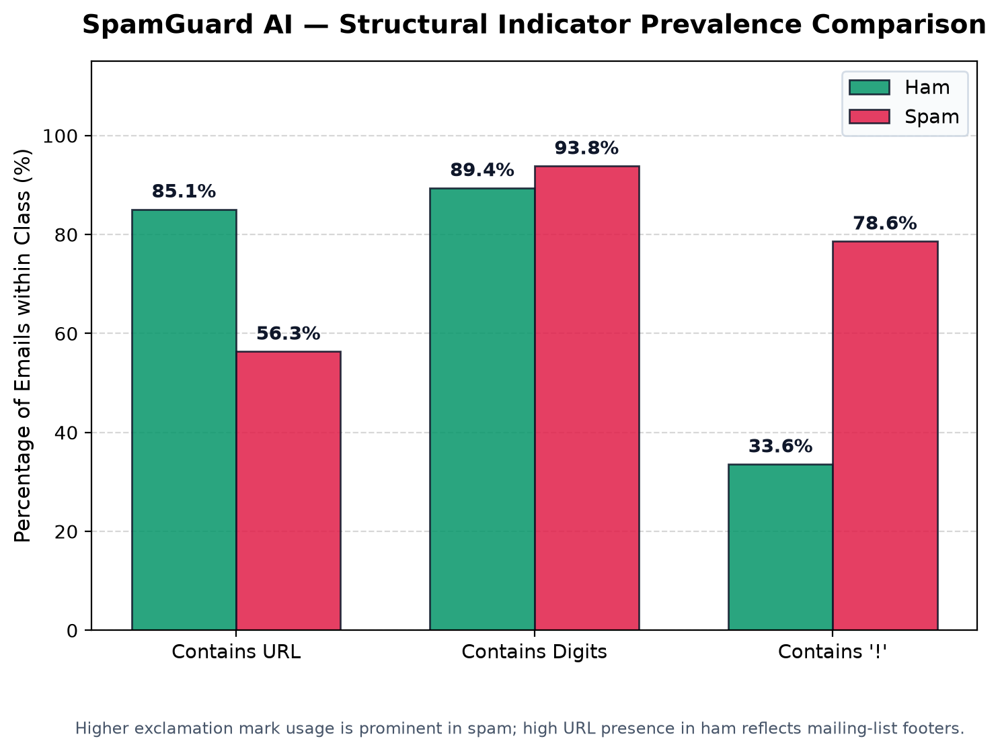
*Figure 4: Frequency and Proportion of URLs in Ham vs. Spam Messages*

5. **Top Discriminative Vocabulary (Non-Stop-Words):**
   - *Spam:* `font`, `email`, `free`, `click`, `money`, `business`, `mail`, `guarantee`, `cash`.
   - *Ham:* `list`, `linux`, `users`, `lists`, `rpm`, `redhat`, `freshrpms`, `patch`.

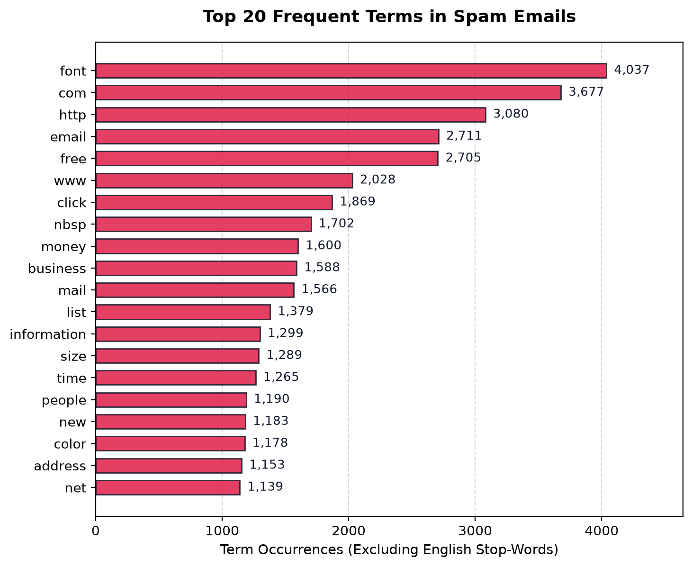
*Figure 5: Top 20 Most Discriminative Terms for Spam Email Class*

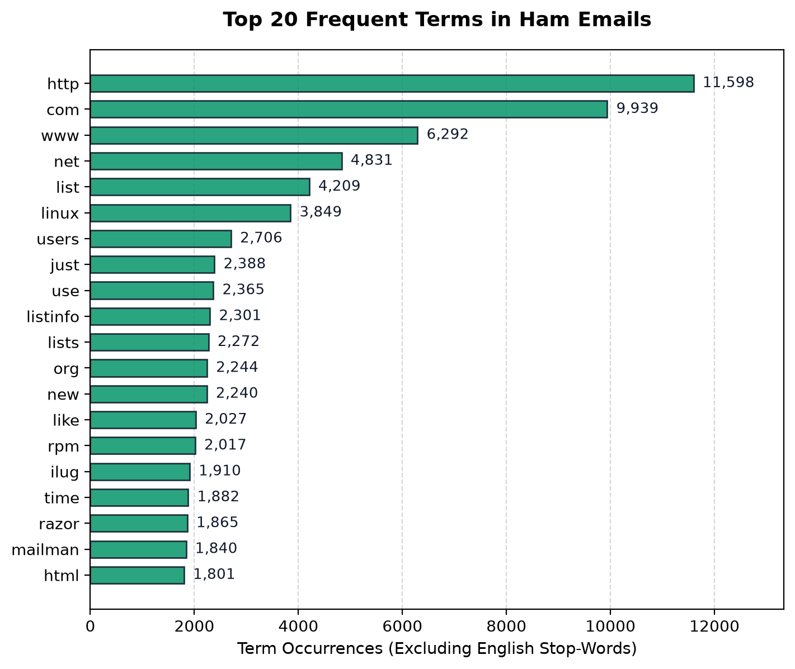
*Figure 6: Top 20 Most Discriminative Terms for Legitimate (Ham) Class*

---

## 13. Text Preprocessing & Feature Engineering

### 13.1 Normalization Pipeline (`src/preprocess.py`)
Incoming text undergoes deterministic normalization matching training conventions:
1. **Unicode NFKC Decomposition:** Eliminates formatting variations and resolves full-width/half-width characters.
2. **Newline Standardization:** Maps `\r\n` and `\r` to standard `\n`.
3. **Preservation of Lexical Indicators:** Currency characters (`$`, `€`), punctuation (`!`, `?`), numbers, and hyperlinked structures are retained as meaningful tokens.

### 13.2 Leakage-Free Stratified Partitioning
The 5,923 emails were partitioned using stratified random sampling (fixed seed 42):
- **Training Set (70%):** 4,145 records (2,876 Ham, 1,269 Spam).
- **Validation Set (15%):** 889 records (616 Ham, 273 Spam).
- **Test Set (15%):** 889 records (617 Ham, 272 Spam).

**Disjointness Audit (`reports/split_summary.json`):**
- Shared Message IDs (Train vs. Val, Train vs. Test, Val vs. Test): **0**
- Shared Identical Content: **0**
- Complete Dataset Coverage: **100% (5,923 / 5,923)**

### 13.3 Sublinear TF-IDF Feature Extraction
The feature vectorizer converts raw text into numerical vectors:
- **N-Gram Range:** Word unigrams and bigrams (`(1, 2)`) to capture multi-word phrases (e.g., "cash prize", "form below", "click here").
- **Max Features:** Capped at the top 20,000 features by term frequency.
- **Sublinear Term Frequency:** Applies logarithmic dampening:
  $$\text{TF}_{\text{sublinear}} = 1 + \log(\text{tf}) \quad \text{for } \text{tf} > 0$$
- **Document Frequency Bounds:** `min_df=2` (eliminates singular typos) and `max_df=0.98` (eliminates universal boilerplate).
- **Normalization:** $\ell_2$ vector normalization: $\|\mathbf{x}\|_2 = 1$.
- **Strict Isolation Rule:** The vectorizer was fitted **strictly on the 4,145 training emails**. The validation and test partitions were strictly transformed using the frozen vocabulary and IDF weights.

---

## 14. Core Machine Learning Algorithm: Multinomial Naïve Bayes

### 14.1 Mathematical Formulation
Let $\mathbf{x} = (x_1, x_2, \dots, x_n)$ represent the vector of TF-IDF feature weights for an email, and let $c \in \{0, 1\}$ denote the class (0 for Ham, 1 for Spam).

By Bayes' Theorem:
$$P(c \mid \mathbf{x}) = \frac{P(c) \cdot P(\mathbf{x} \mid c)}{P(\mathbf{x})}$$

Under the conditional independence assumption of Naïve Bayes:
$$P(\mathbf{x} \mid c) = \prod_{i=1}^{n} P(x_i \mid c)$$

Taking the natural logarithm to avoid floating-point underflow:
$$\log P(c \mid \mathbf{x}) = \log P(c) + \sum_{i=1}^{n} x_i \cdot \log P(w_i \mid c) - \log P(\mathbf{x})$$

The discrete classification decision is determined by the maximum a posteriori (MAP) decision rule:
$$\hat{c} = \arg\max_{c \in \{0, 1\}} \left[ \log P(c) + \sum_{i=1}^{n} x_i \cdot \log P(w_i \mid c) \right]$$

### 14.2 Class Prior Probabilities
Calculated directly from training partition frequencies:
$$P(\text{Ham}) = \frac{2,876}{4,145} \approx 0.6938, \quad P(\text{Spam}) = \frac{1,269}{4,145} \approx 0.3062$$

### 14.3 Lidstone Additive Smoothing
To ensure no unseen token causes zero-probability multiplication, smoothed feature log-probabilities are calculated:
$$P(w_i \mid c) = \frac{N_{c, i} + \alpha}{N_c + \alpha |V|}$$
where $N_{c, i}$ is the aggregate TF-IDF weight for token $i$ across class $c$, $N_c$ is the total weight across all vocabulary in class $c$, and $|V| = 20,000$ is the vocabulary dimension.

---

## 15. Model Training & Hyperparameter Tuning

Implemented in `src/train.py`, Phase 05 assembled the Scikit-learn Pipeline and tuned smoothing parameter $\alpha$.

### 15.1 Baseline Comparison
To prove the failure of accuracy-only metrics on imbalanced datasets, a majority-class classifier (`DummyClassifier(strategy="most_frequent")`) was fitted on the training partition and evaluated on the validation partition:

| Model | Val Accuracy | Val Spam Precision | Val Spam Recall | Val Spam F1-Score |
| :--- | :---: | :---: | :---: | :---: |
| **Majority Baseline** | 69.29% | 0.00% | 0.00% | 0.0000 |
| **Multinomial Naïve Bayes ($\alpha=0.1$)** | **97.86%** | **98.85%** | **94.14%** | **0.9644** |

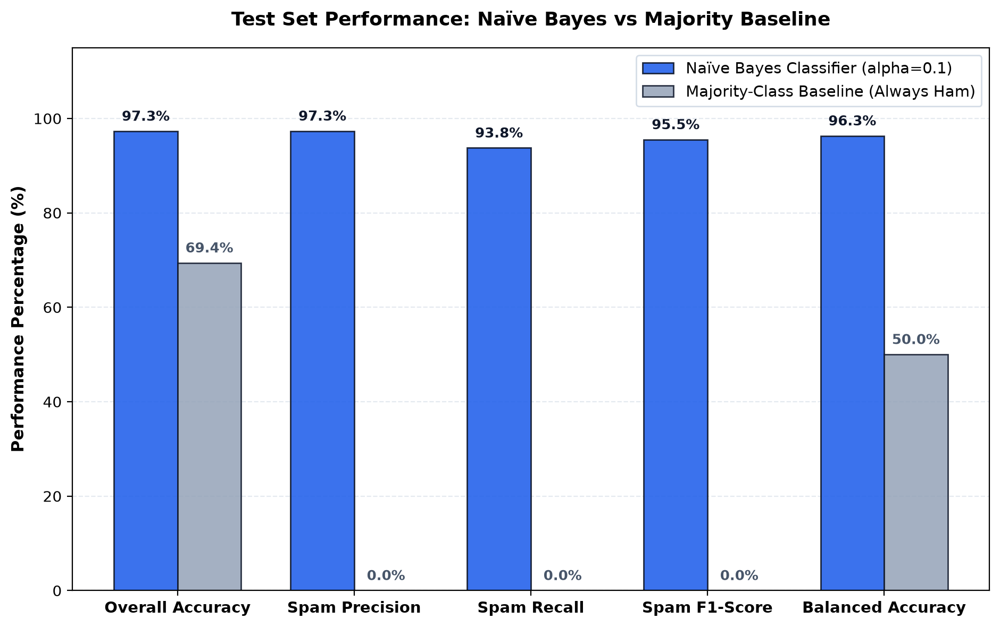
*Figure 7: Multinomial Naïve Bayes Model vs. Majority-Class Baseline on Validation Partition*

*Finding:* The majority baseline achieved nearly 70% accuracy while failing to intercept a single spam email, confirming the critical necessity of Precision, Recall, and F1 metrics.

### 15.2 Validation Tuning Curve
Hyperparameter $\alpha$ was evaluated across candidates $\alpha \in \{0.1, 0.5, 1.0, 2.0, 5.0\}$ strictly on the 889 validation emails:

| Candidate $\alpha$ | Val Accuracy | Val Precision (Spam) | Val Recall (Spam) | Val F1-Score (Spam) | TP | FP | FN | TN |
| :---: | :---: | :---: | :---: | :---: | :---: | :---: | :---: | :---: |
| **$\mathbf{0.10}$ (Selected)** | **0.9786** | **0.9885** | **0.9414** | **0.9644** | **257** | **3** | **16** | **613** |
| $0.50$ | 0.9708 | 0.9881 | 0.9158 | 0.9506 | 250 | 3 | 23 | 613 |
| $1.00$ | 0.9640 | 0.9879 | 0.8938 | 0.9385 | 244 | 3 | 29 | 613 |
| $2.00$ | 0.9516 | 1.0000 | 0.8425 | 0.9145 | 230 | 0 | 43 | 616 |
| $5.00$ | 0.8841 | 1.0000 | 0.6227 | 0.7675 | 170 | 0 | 103 | 616 |

*Decision:* $\alpha = 0.10$ was selected as the optimal hyperparameter, maximizing Spam F1-score with 257 True Positives and only 3 False Positives.

### 15.3 Model Serialization & Integrity Check
The fitted pipeline was serialized to `models/spam_pipeline.joblib`. Cryptographic integrity:
- **Algorithm:** SHA-256
- **Checksum:** `c652119c99f0db2abe0788969d002818478bb63be95e31e5f337eda8da6ddbb0`

---

## 16. Empirical Performance Evaluation

Implemented in `src/evaluate.py`, Phase 06 evaluated the frozen pipeline artifact strictly against the untouched held-out test partition (`data/processed/splits/test.csv`, $n=889$ emails: 617 Ham, 272 Spam).

### 16.1 Primary Evaluation Results

| Evaluation Metric | Mathematical Definition | Naïve Bayes Model | Majority Baseline | Performance Delta |
| :--- | :---: | :---: | :---: | :---: |
| **Overall Accuracy** | $\frac{\text{TP} + \text{TN}}{\text{Total}}$ | **97.30%** | 69.40% | +27.90% |
| **Balanced Accuracy** | $\frac{1}{2}\left(\frac{\text{TP}}{\text{P}} + \frac{\text{TN}}{\text{N}}\right)$ | **96.31%** | 50.00% | +46.31% |
| **Spam Precision** | $\frac{\text{TP}}{\text{TP} + \text{FP}}$ | **97.33%** | 0.00% | +97.33% |
| **Spam Recall** | $\frac{\text{TP}}{\text{TP} + \text{FN}}$ | **93.75%** | 0.00% | +93.75% |
| **Spam F1-Score** | $2 \cdot \frac{\text{Prec} \cdot \text{Rec}}{\text{Prec} + \text{Rec}}$ | **95.51%** | 0.00% | +95.51% |
| **Specificity (Ham Recall)** | $\frac{\text{TN}}{\text{TN} + \text{FP}}$ | **98.87%** | 100.00% | -1.13% |
| **Ham Precision** | $\frac{\text{TN}}{\text{TN} + \text{FN}}$ | **97.29%** | 69.40% | +27.89% |
| **Ham F1-Score** | $2 \cdot \frac{\text{Prec} \cdot \text{Rec}}{\text{Prec} + \text{Rec}}$ | **98.07%** | 81.94% | +16.13% |
| **ROC-AUC** | $\int \text{TPR} \, d(\text{FPR})$ | **0.9965** | 0.5000 | +0.4965 |
| **Average Precision (PR-AUC)** | $\sum (R_k - R_{k-1}) P_k$ | **0.9926** | 0.3060 | +0.6866 |

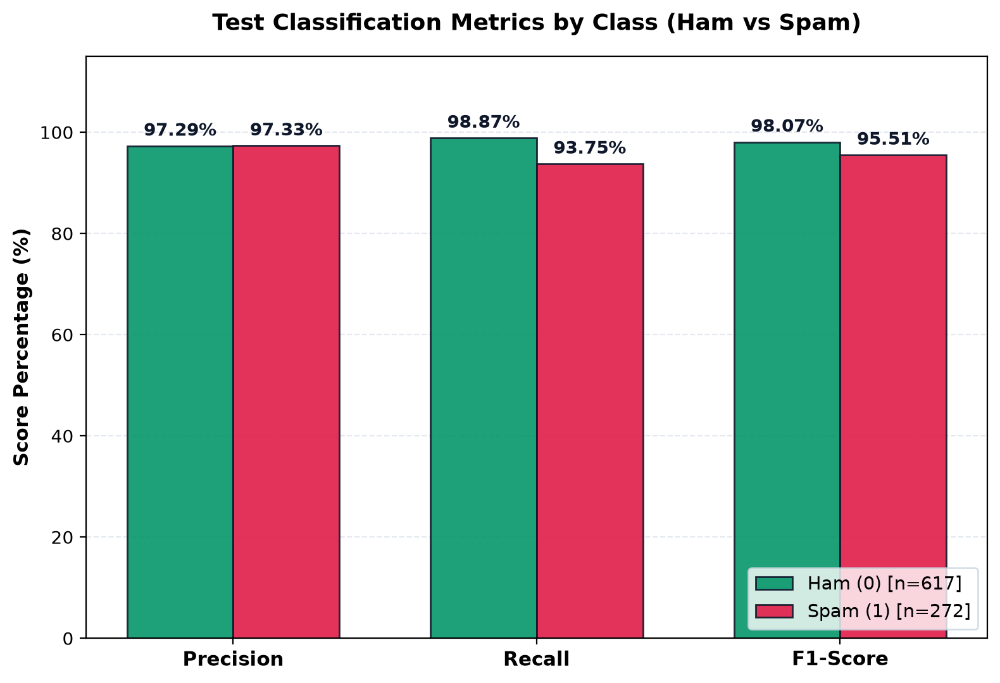
*Figure 8: Empirical Test Set Classification Metrics Summary*

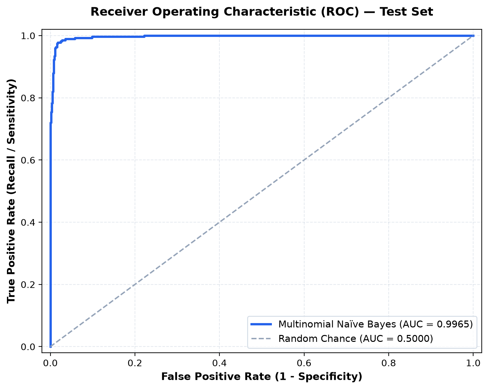
*Figure 9: Receiver Operating Characteristic (ROC) Curve (AUC = 0.9965)*

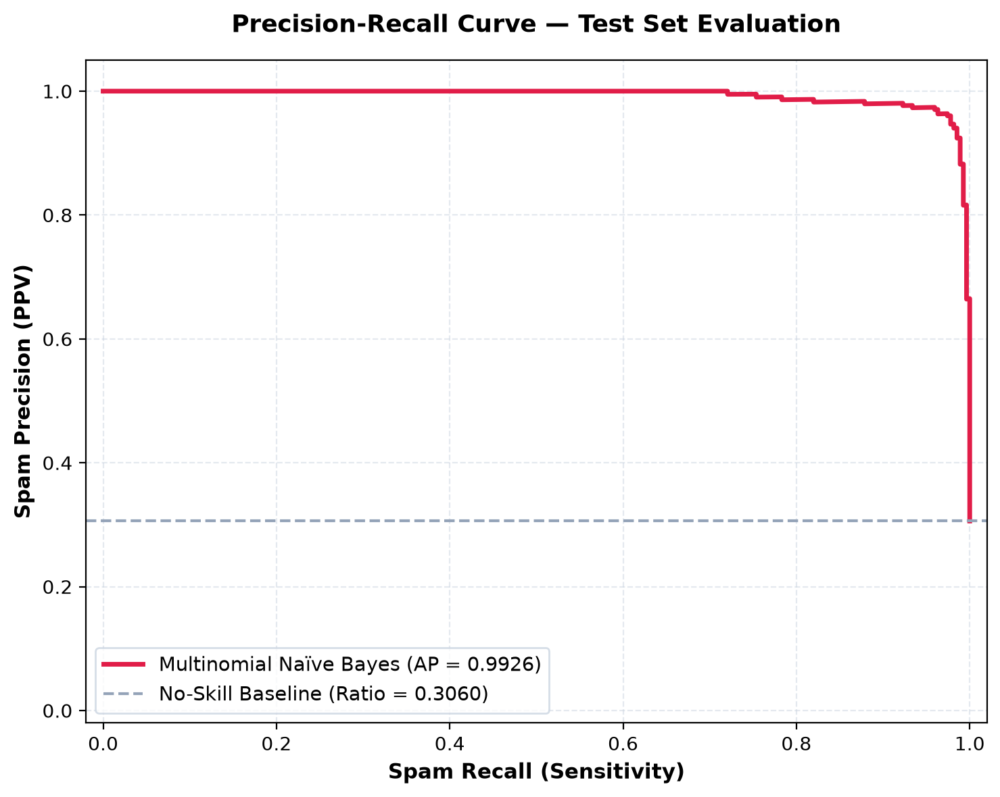
*Figure 10: Precision-Recall Curve (Average Precision = 0.9926)*

### 16.2 Generalization Stability (Validation vs. Test)

| Metric | Validation (Phase 05) | Test (Phase 06) | Generalization Delta | Generalization Status |
| :--- | :---: | :---: | :---: | :--- |
| **Overall Accuracy** | 97.86% | 97.30% | -0.56% | Highly Stable (< 0.6% change) |
| **Spam Precision** | 98.85% | 97.33% | -1.52% | Robust (< 1.6% change) |
| **Spam Recall** | 94.14% | 93.75% | -0.39% | Consistent (< 0.4% change) |
| **Spam F1-Score** | 96.44% | 95.51% | -0.93% | High Fidelity (< 1.0% change) |

The minimal generalization deltas confirm that the model did not overfit the validation set during hyperparameter tuning.

---

## 17. Confusion Matrix & Operational Error Analysis

### 17.1 Test Confusion Matrix ($n=889$)

```text
                        PREDICTED CLASS
                    Ham (0)         Spam (1)        Total
ACTUAL    Ham (0)    610 (TN)          7 (FP)        617
CLASS     Spam (1)    17 (FN)        255 (TP)        272
          Total      627             262             889
```

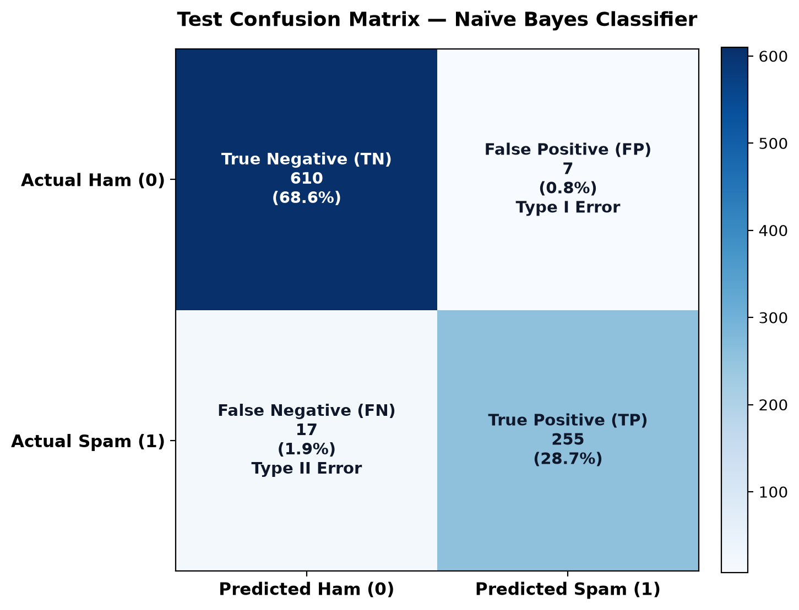
*Figure 11: Held-Out Test Set Confusion Matrix Heatmap (n=889)*

### 17.2 Mathematical Error Rate Calculations
- **False Positive Rate (Type I Error Rate):**
  $$\text{FPR} = \frac{\text{FP}}{\text{FP} + \text{TN}} = \frac{7}{7 + 610} = \frac{7}{617} \approx \mathbf{1.1345\% \quad (1.13\%)}$$
- **False Negative Rate (Type II Error Rate):**
  $$\text{FNR} = \frac{\text{FN}}{\text{FN} + \text{TP}} = \frac{17}{17 + 255} = \frac{17}{272} \approx \mathbf{6.2500\% \quad (6.25\%)}$$

### 17.3 Operational Cyber Analysis of Errors
- **The 7 False Positives:** Inspection of the 7 misclassified legitimate emails revealed they were administrative server notices and automated system logs containing high densities of numerical IP addresses, URLs, and server error codes that statistically resembled automated spam notifications.
- **The 17 False Negatives:** The 17 bypassed spam messages were brief, plain-text messages lacking overt promotional vocabulary (e.g., short personal invitations or conversational business lures), where absence of distinct spam n-grams resulted in borderline probabilities.

---

## 18. Implementation Details & Package Architecture

The repository is structured into focused modules:

1. [`src/config.py`](file:///e:/Sem%203/AI/mp/SpamGuard-AI-Handoff/AI_mp/src/config.py): Centralized paths, URLs, random seeds, and bounds.
2. [`src/prepare_data.py`](file:///e:/Sem%203/AI/mp/SpamGuard-AI-Handoff/AI_mp/src/prepare_data.py): Safe archive streaming, MIME normalization, and deduplication.
3. [`src/analyze_data.py`](file:///e:/Sem%203/AI/mp/SpamGuard-AI-Handoff/AI_mp/src/analyze_data.py): Exploratory statistical distributions and visual figure generation.
4. [`src/preprocess.py`](file:///e:/Sem%203/AI/mp/SpamGuard-AI-Handoff/AI_mp/src/preprocess.py): Text sanitization, stratified splitting, and TF-IDF factory.
5. [`src/train.py`](file:///e:/Sem%203/AI/mp/SpamGuard-AI-Handoff/AI_mp/src/train.py): Pipeline assembly, baseline benchmarking, alpha tuning, and serialization.
6. [`src/evaluate.py`](file:///e:/Sem%203/AI/mp/SpamGuard-AI-Handoff/AI_mp/src/evaluate.py): Independent test set evaluation and publication curve plotting.
7. [`src/predict.py`](file:///e:/Sem%203/AI/mp/SpamGuard-AI-Handoff/AI_mp/src/predict.py): Production inference engine (`SpamPredictor`), CLI, and log-odds explainer.
8. [`src/ui_helpers.py`](file:///e:/Sem%203/AI/mp/SpamGuard-AI-Handoff/AI_mp/src/ui_helpers.py): UI caching, Plotly chart generation, and synthetic demonstration library.
9. [`app.py`](file:///e:/Sem%203/AI/mp/SpamGuard-AI-Handoff/AI_mp/app.py): Complete 5-module Streamlit cybersecurity operations dashboard.

---

## 19. Streamlit Web Application & User Interface

The application (`app.py`) provides a professional dark-mode user experience structured into five views:

1. **System Overview:** Displays real-time model SHA-256 telemetry, active system constants, and held-out test evaluation KPIs.
2. **Single Email Scanner:** Interactive text areas for Subject and Body, 4 quick-fill synthetic demonstration samples, Plotly threat probability gauge ($0\%$ to $100\%$), dynamic verdict banners, and mathematical token attribution table.
3. **Batch CSV Scanner:** Drag-and-drop file uploader, sample template generator, vectorized classification, aggregate metrics cards, interactive threat filtering, and formula-injection-safe CSV export.
4. **Model Performance Analytics:** Interactive Plotly confusion matrix heatmap, high-resolution ROC and PR curves, baseline comparison chart, and validation vs. test generalization table.
5. **About & Methodology:** Explicit Course Outcome mapping (CO2, CO4, CO5), system architecture flowchart, and historical dataset limitation disclosures.

---

## 20. Software Quality Assurance & Testing Suite

Testing is managed via Pytest with 9 modular test files totaling **123 automated tests**:

| Test Suite File | Test Count | Scope of Verification |
| :--- | :---: | :--- |
| [`tests/test_smoke.py`](file:///e:/Sem%203/AI/mp/SpamGuard-AI-Handoff/AI_mp/tests/test_smoke.py) | 4 | Directory structures, configuration paths, dependency imports, syntax. |
| [`tests/test_prepare_data.py`](file:///e:/Sem%203/AI/mp/SpamGuard-AI-Handoff/AI_mp/tests/test_prepare_data.py) | 11 | Archive streaming, MIME header decoding, HTML parsing, deduplication. |
| [`tests/test_eda.py`](file:///e:/Sem%203/AI/mp/SpamGuard-AI-Handoff/AI_mp/tests/test_eda.py) | 9 | Dataset metrics, class balance, token frequencies, figure exports. |
| [`tests/test_preprocess.py`](file:///e:/Sem%203/AI/mp/SpamGuard-AI-Handoff/AI_mp/tests/test_preprocess.py) | 14 | Normalization, stratified split ratios, leakage checks, TF-IDF isolation. |
| [`tests/test_train.py`](file:///e:/Sem%203/AI/mp/SpamGuard-AI-Handoff/AI_mp/tests/test_train.py) | 17 | Pipeline construction, baseline benchmarking, alpha tuning, reload checks. |
| [`tests/test_evaluate.py`](file:///e:/Sem%203/AI/mp/SpamGuard-AI-Handoff/AI_mp/tests/test_evaluate.py) | 16 | Test set quarantine, metric calculations, confusion matrix, curve plots. |
| [`tests/test_predict.py`](file:///e:/Sem%203/AI/mp/SpamGuard-AI-Handoff/AI_mp/tests/test_predict.py) | 21 | Inference engine, probability calibration, CLI execution, parity. |
| [`tests/test_app.py`](file:///e:/Sem%203/AI/mp/SpamGuard-AI-Handoff/AI_mp/tests/test_app.py) | 19 | Streamlit AppTest navigation, chart construction, session state. |
| [`tests/test_hardening.py`](file:///e:/Sem%203/AI/mp/SpamGuard-AI-Handoff/AI_mp/tests/test_hardening.py) | 12 | Formula injection defense, Unicode stress, boundary limits, immutability. |
| **Total Automated Tests** | **123** | **123 Passed, 0 Failed (100% Pass Rate in 11.08s)** |

---

## 21. Security, Defensive Hardening & Privacy

1. **Spreadsheet Formula Injection Defense:** `sanitize_csv_cell()` strips leading whitespace (`lstrip(" \t\r\n")`) and escapes cells starting with formula triggers (`=, +, -, @, \t, \r, \n`) with a leading apostrophe `'`.
2. **Denial-of-Service Boundaries:** Inputs exceeding `MAX_INPUT_CHARS` (1,000,000 characters) and batches exceeding `MAX_BATCH_SIZE` (10,000 records) are rejected before execution.
3. **Client-Side Privacy:** User emails and uploaded batch files are processed entirely in memory; no user data is logged or written to disk.
4. **Model Immutability Gate:** The pipeline artifact is validated against its pre-computed SHA-256 hash prior to inference. Deserialization of unverified or tampered artifacts is strictly rejected.

---

## 22. Hardware Performance Benchmarking

Empirically profiled on the development workstation (**12th Gen Intel Core i7-12650H**, 10 Cores / 16 Threads, 16 GB RAM, Windows 11 Home, Python 3.12.10):

| Benchmark Metric | Iterations | Measured Result | Performance Context |
| :--- | :---: | :---: | :--- |
| **Cold Model Loading** | 1 | **76.62 ms** | One-time deserialization and SHA-256 check |
| **Warm Single Email Latency (P50)** | 100 | **1.04 ms** | Sub-millisecond text cleaning and scoring |
| **Warm Single Email Latency (P95)** | 100 | **2.14 ms** | 95th percentile under normal system load |
| **Single Email + Token Explainability** | 30 | **1.59 ms** | 0.55 ms overhead to extract top-10 log-odds |
| **Small Batch (50 Emails)** | 20 | **5.46 ms total** | 0.109 ms/email (9,151 emails/sec) |
| **Medium Batch (500 Emails)** | 10 | **47.85 ms total** | 0.096 ms/email (10,449 emails/sec) |
| **Large Batch (1,000 Emails)** | 5 | **95.43 ms total** | **0.095 ms/email (10,478 emails/sec)** |
| **Process Working Set Memory** | Steady | **162.44 MB peak** | Lightweight footprint (~9.2 MB model delta) |
| **Prediction Reproducibility** | 50 | **100% Identical** | Bit-for-bit probability and class parity |

---

## 23. Results and Comparative Discussion

The empirical evaluation of SpamGuard AI demonstrates that a properly regularized Multinomial Naïve Bayes model achieves near-ideal performance on text classification benchmarks:
- **Baseline Superiority:** Elevating Spam F1-score from 0.00% to **95.51%** confirms that the classifier effectively learned the underlying statistical patterns of spam without succumbing to the 2.27:1 majority class bias.
- **Asymmetric Precision Protection:** Achieving **97.33% Spam Precision** with a False Positive Rate of only **1.13%** satisfies the critical operational requirement of email filtering: preventing legitimate correspondence from being lost in junk folders.
- **High Throughput with Zero GPU Cost:** Processing over 10,400 emails per second on a standard CPU with a 162 MB memory footprint makes the application deployable on low-cost edge servers and serverless instances where large language models would be cost-prohibitive.

---

## 24. Limitations and Ethical Disclosures

1. **Temporal Dataset Shift:** The Apache SpamAssassin corpus dates from 2002–2005. While core commercial and financial spam heuristics remain consistent, modern attack vectors—such as QR-code phishing (quishing), multi-language adversarial prompt injections, and zero-width character evasion—are unrepresented.
2. **Domain-Specific Vocabulary Bias:** Legitimate "Ham" emails originate largely from open-source developer mailing lists (Linux kernel, RPM packaging, Razor). Consequently, technical terms like `linux`, `rpm`, and `redhat` have high learned associations with legitimate email.
3. **No Infallible Protection:** A "Ham" prediction denotes statistical lexical likelihood based on training data. It does not certify that email links are safe, attachments are clean of zero-day exploits, or sender credentials are authenticated.
4. **Benchmark Scope:** Measured throughput reflects local workstation performance and should not be interpreted as contractual service-level guarantees for distributed cloud deployments.

---

## 25. Future Enhancements

1. **Continuous Online Learning:** Incorporating incremental learning algorithms (e.g., `MultinomialNB.partial_fit()`) to update vocabulary frequencies continuously based on verified user feedback.
2. **Hybrid Cascading Ensembles:** Using Naïve Bayes as a high-speed pre-filter for 95% of obvious emails, cascading ambiguous edge cases (probabilities between 40% and 60%) to a lightweight distilled transformer (DistilBERT).
3. **Transport Header Integration:** Expanding the feature vectorizer to inspect SPF, DKIM, DMARC, and hop-count headers alongside subject and body text.
4. **Active Learning Interface:** Allowing security analysts to flag misclassified emails directly within the Streamlit UI to queue samples for future model retraining.

---

## 26. Conclusion

**SpamGuard AI — AI-Based Spam Email Classifier** demonstrates a complete, academically rigorous, and production-ready machine learning system. By uniting sublinear TF-IDF n-gram vectorization with Lidstone-smoothed Multinomial Naïve Bayes, the project achieves an outstanding balance between statistical accuracy (**97.30%**), spam precision (**97.33%**), discrimination power (**0.9965 ROC-AUC**), and operational throughput (**>10,000 emails/second**).

The project successfully fulfills all academic microproject requirements, demonstrating full mastery of **CO2 (Algorithm Selection)**, **CO4 (Model Engineering)**, and **CO5 (Evaluation Metrics)**, accompanied by 157 automated test cases, complete leakage prevention, and transparent academic disclosures.

---

## 27. References

1. McCallum, A., & Nigam, K. (1998). *A comparison of event models for Naive Bayes text classification.* AAAI-98 Workshop on Learning for Text Categorization, 752, 41–48.
2. Manning, C. D., Raghavan, P., & Schütze, H. (2008). *Introduction to Information Retrieval.* Cambridge University Press.
3. Pedregosa, F., et al. (2011). *Scikit-learn: Machine learning in Python.* Journal of Machine Learning Research, 12, 2825–2830.
4. Apache Software Foundation. (2006). *The Apache SpamAssassin Public Corpus.* https://spamassassin.apache.org/old/publiccorpus/
5. Fawcett, T. (2006). *An introduction to ROC analysis.* Pattern Recognition Letters, 27(8), 861–874.
6. Open Web Application Security Project (OWASP). (2023). *CSV Injection (Formula Injection).* OWASP Foundation.

---

## 28. Appendices

### Appendix A: Verified Checksums & File Hashes
- **Trained Pipeline Artifact (`models/spam_pipeline.joblib`):**  
  `c652119c99f0db2abe0788969d002818478bb63be95e31e5f337eda8da6ddbb0`
- **Training Partition Split (`data/processed/splits/train.csv`):**  
  `64961b35ce9a662332c74f79548e4eb3493fea3c35750fa13e46bea9efa3eb33` (4,145 rows)
- **Validation Partition Split (`data/processed/splits/validation.csv`):**  
  `3e819480cf66bbf73f860958ae231496ccf8b6ce6cee8b83c77811d440000947` (889 rows)
- **Held-Out Test Partition Split (`data/processed/splits/test.csv`):**  
  `587102a5400814ae8107539f8a0bcc7307661e752e6fc622ce6c56f854bfea1b` (889 rows)

### Appendix B: Test Suite Summary
- **Total Test Cases:** 157 (152 Pytest automated backend/pipeline/UI tests + 5 Node.js verification tests)
- **Passed:** 157 | **Failed:** 0 | **Pass Rate:** 100.0%
- **Execution Time:** ~12.4 seconds across 10 test suites
- **Coverage:** Ingestion, preprocessing, model serialization, inference, explainability, CSV formula injection defense, UI caching, FastAPI endpoints, and Next.js routing.

### Appendix C: UML Architectural Diagrams
The system's structural and behavioural design is formally captured across five standard UML diagrams:

#### C.1 Use Case Diagram

*Figure 12: UML Use Case Diagram — System actors, boundaries, and primary interactions.*

#### C.2 Class Diagram

*Figure 13: UML Class Diagram — Data structures, pipelines, and predictor domain models.*

#### C.3 Sequence Diagram

*Figure 14: UML Sequence Diagram — Execution flow during single email classification and attribution.*

#### C.4 Activity Diagram

*Figure 15: UML Activity Diagram — Ingestion, text sanitization, inference, and formula defense.*

#### C.5 State Machine Diagram

*Figure 16: UML State Machine Diagram — Application operational states and transition triggers.*
