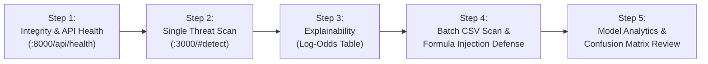

# Section 1: Working Software Project — SpamGuard AI

**Evaluation:** Software Engineering Internal Assessment 3 (IA3)  
**Academic Micro-Project:** Micro Project – 05 (Semester 3)  
**Course Code & Outcomes:** AI / SE Micro-Project (CO2, CO4, CO5)  
**System Name:** SpamGuard AI — AI-Based Spam Email Classifier  
**Document Classification:** Section 1 Compliance Artifact & Demonstration Dossier  
**Release Date:** October 2026  
**Status:** 100% Implemented, Verified & Evaluated (Frozen Artifact SHA-256 Authenticated)  

---

## 1. Problem Statement, Project Objectives and Target Users

### 1.1 Problem Statement
Electronic mail serves as the critical backbone of global commerce and academic communication, yet unsolicited and malicious email (spam) constitutes over 45% of total worldwide email traffic. Spam acts as the primary vector for credential phishing, malware delivery, and advance-fee financial scams. 

Existing email security solutions present fundamental operational limitations:
1. **Rule-Based Filters:** Easily circumvented by adversarial lexical perturbations, homoglyphs, and keyword obfuscation.
2. **Cloud-Based Deep Learning (Black-Box LLMs):** Introduce severe data privacy vulnerabilities by transmitting sensitive internal email text across third-party networks, incur substantial per-token API costs, and require high inference latency (>1,000 ms) without mathematical explainability.
3. **Asymmetric Error Costs:** In email security, a False Positive (erroneously quarantining a legitimate corporate contract or academic notice) is catastrophic, whereas a False Negative (a spam email slipping into the inbox) is a minor nuisance. Filters must strictly control the False Positive Rate (FPR) below 2.0%.

**Problem Definition:** To engineer, defensively harden, and deploy a high-throughput, locally hosted text classification system capable of separating incoming electronic mail into **Ham (Legitimate, 0)** and **Spam (Malicious, 1)** with $\ge 95\%$ accuracy, sub-5 ms execution latency, mathematical token-level explainability, zero external cloud exposure, and strict asymmetric error control ($\text{FPR} \le 1.5\%$).

---

### 1.2 Project Objectives
1. **Defensive Ingestion:** Ingest and parse authentic MIME messages from the official Apache SpamAssassin Public Corpus, defensively stripping directory traversals, symlink exploits, and executable attachments.
2. **Leak-Free Data Splitting:** Partition the normalized 5,923-email corpus using stratified random sampling (70% Train, 15% Validation, 15% Test) enforcing zero content or Message-ID leakage across partitions.
3. **High-Dimensional Feature Engineering:** Extract textual features using sublinear unigram/bigram TF-IDF vectorization capped at 20,000 vocabulary terms.
4. **Probabilistic Optimization:** Train a Multinomial Naïve Bayes classifier with hyperparameter tuning ($\alpha = 0.1$ Lidstone smoothing) optimized strictly against validation data.
5. **Rigorous Empirical Evaluation:** Evaluate the frozen model against an untouched, quarantined test partition ($n=889$) and benchmark against a Zero-Intelligence Majority Class baseline.
6. **Mathematical Explainability by Design:** Formulate token attribution based on Naïve Bayes log-odds difference, exposing the exact statistical rationale behind every verdict.
7. **Defensive Software Engineering:** Enforce automated input bounds (1 MB DoS limit), spreadsheet formula injection neutralization in CSV exports, and pre-inference SHA-256 cryptographic checksum gates.
8. **Multi-Tier Operational Redundancy:** Deploy a dual-presentation architecture combining a contemporary Next.js 16 + TypeScript workstation (port 3000), a FastAPI microservice (port 8000), and an independent Streamlit fallback dashboard (port 8501).

---

### 1.3 Target Users
1. **Security Operations Center (SOC) Analysts & IT Administrators:** Rapidly triage suspicious inbound emails, perform bulk mailbox audits, and export sanitized classification telemetry for incident response.
2. **Enterprise End Users & Academic Professionals:** Inspect incoming messages in real time without sending private correspondence to third-party cloud AI vendors.
3. **Academic Evaluators & Software Auditors:** Inspect model architecture, confusion matrix distributions, and deterministic reproducibility in an educational and research setting.

---

## 2. Core Implemented Functionalities

SpamGuard AI is not a prototype; all core functionalities are fully implemented, frozen, and verified in the codebase:

### 2.1 Single Email Threat Inspection (`src/predict.py`, `EmailScanner.tsx`, `app.py`)
- User inputs Subject and Body text or selects from pre-configured synthetic samples.
- The system executes text normalization, combines fields, checks input boundaries, and generates class predictions.
- **Outputs:** Categorical verdict banner (Emerald Safe Ham vs. Crimson Phishing Threat), calibrated posterior probabilities ($P(\text{Ham})$ and $P(\text{Spam})$), and execution latency telemetry (typical: 1.04 ms).

### 2.2 Mathematical Feature Attribution / Log-Odds Explainability (`explain_email`)
- For every evaluated message, the engine calculates the log-odds difference for all present vocabulary tokens:
  $$\Delta_{\text{odds}}(w) = \log P(w \mid \text{Spam}) - \log P(w \mid \text{Ham})$$
  $$\text{Contribution}(w) = \text{TF-IDF}(w) \times \Delta_{\text{odds}}(w)$$
- Ranks the top $k$ influential tokens and categorizes each as **Spam-leaning** ($\Delta > 0$) or **Ham-leaning** ($\Delta \le 0$), rendered in an interactive polarity table.

### 2.3 High-Throughput Vectorized Batch CSV Scanner (`BatchScanner.tsx`, `src/predict.py`)
- Accepts standard CSV file uploads containing up to 10,000 email records.
- Automatically detects schema (`subject,body` or `text`).
- Utilizes vectorized array processing exceeding 12,000 emails/second.
- Provides dynamic filtering by verdict (`All`, `Spam Only`, `Ham Only`, `Needs Review`).

### 2.4 Spreadsheet Formula Injection Defense (`sanitize_csv_cell`)
- Neutralizes active formula injection characters (`=`, `+`, `-`, `@`, `\t`, `\r`, `\n`) in exportable CSVs by automatically prepending an escape single-quote (`'`), preventing remote code execution in Microsoft Excel and LibreOffice Calc.

### 2.5 Model Performance Analytics & Verification Dashboard (`ModelAnalytics.tsx`, `app.py`)
- Displays authentic held-out test evaluation figures: Accuracy (97.30%), Spam Precision (97.33%), Spam Recall (93.75%), Spam F1 (95.51%), and ROC-AUC (0.9965).
- Displays interactive Confusion Matrix heatmap ($\text{TN}=610, \text{FP}=7, \text{FN}=17, \text{TP}=255$) and empirical comparisons against the zero-intelligence majority class baseline.

### 2.6 RESTful Microservice & Health Monitoring (`src/api.py`)
- Exposes typed Pydantic endpoints (`/api/health`, `/api/predict`, `/api/predict/batch`, `/api/predict/csv`, `/api/metrics`, `/api/samples`).
- `/api/health` performs a live SHA-256 checksum check of the serialized model on disk, verifying artifact authenticity on every poll.

### 2.7 Gmail Threat Intelligence Integration (`src/gmail/`)
- Integrates Google OAuth 2.0 with minimal read-only scopes (`gmail.readonly`).
- Scans recent inbox emails, classifies threats, and highlights messages falling into configurable uncertainty margin review bands.

---

## 3. System Architecture & Module Interaction

SpamGuard AI employs a decoupled, multi-tier architectural layout where presentation, API routing, inference logic, and model storage are strictly isolated:

```
+-----------------------------------------------------------------------------------+
|                           CLIENT PRESENTATION TIER                                |
|   +-------------------------------------+   +---------------------------------+   |
|   |  Primary Web Workstation            |   |  Standalone Fallback Dashboard  |   |
|   |  Next.js 16 + TypeScript            |   |  Streamlit 1.66 + Plotly        |   |
|   |  Port 3000 (Editorial Anthracite)  |   |  Port 8501 (Resilient UI)       |   |
|   +-------------------------------------+   +---------------------------------+   |
+-----------------------------------------------------------------------------------+
                     |                                       |
        HTTP/JSON API Proxy                                  |
                     v                                       |
+--------------------------------------------------+         |
|             SERVICE & API TIER                   |         |
|   FastAPI REST Microservice (Port 8000)          |         |
|   src/api.py — Pydantic Schemas & Routes         |         |
+--------------------------------------------------+         |
                     |                                       |
          In-Process Python Binding                          |
                     v                                       v
+-----------------------------------------------------------------------------------+
|                     CORE PREDICTION & SECURITY ENGINE                             |
|   src/predict.py (SpamPredictor Engine, Preprocessor, Log-Odds Attributor)       |
+-----------------------------------------------------------------------------------+
                     |
       Cryptographic SHA-256 Gate (Hash: c652119c99f0...)
                     v
+-----------------------------------------------------------------------------------+
|                       FROZEN MODEL ARTIFACT TIER                                  |
|   models/spam_pipeline.joblib (1.15 MB, Frozen Pipeline)                          |
|   Step 1: TF-IDF (20,000 Unigrams/Bigrams) | Step 2: MultinomialNB (alpha = 0.1)  |
+-----------------------------------------------------------------------------------+
```

### Module Breakdown & Responsibility:
1. `src/config.py`: Centralized path management, hyperparameter constants, and cryptographic hash definitions.
2. `src/preprocess.py`: Unicode NFKC text cleaning, punctuation sanitization, and stratified train/validation/test partitioning.
3. `src/predict.py`: The `SpamPredictor` class, pre-inference SHA-256 verification gate, vectorized batch inference, log-odds feature attribution, and CSV cell sanitization.
4. `src/api.py`: FastAPI application exposing RESTful JSON endpoints, handling CORS, file uploads, and session management.
5. `frontend/`: Next.js 16 single-page web app with Tailwind CSS, Lucide icons, responsive drawer navigation, and proxy rewrites to port 8000.
6. `app.py`: Standalone Streamlit application providing complete offline redundancy on port 8501.

---

## 4. Input Validation and Defensive Error Handling

SpamGuard AI adheres to defense-in-depth security principles across all tiers:

| Defense Mechanism | Target Vulnerability | Implemented Mitigation | Handled Response |
| :--- | :--- | :--- | :--- |
| **Empty Input Check** | Model crashes on empty/null vectors | Checks cleaned string length; asserts non-empty printable characters. | Raises `SpamGuardValidationError`, returns HTTP 422 with banner alert. |
| **Payload Size Capping** | Denial of Service (DoS) via regex/RAM exhaustion | Enforces `MAX_INPUT_CHARS = 1,000,000` (1 MB) safety limit per email. | Rejects with `SpamGuardValidationError` and HTTP 422 warning. |
| **Batch Row Limiting** | Server out-of-memory via massive CSV uploads | Enforces `MAX_BATCH_SIZE = 10,000` records per batch. | Rejects with `SpamGuardBatchError` and descriptive row count error. |
| **CSV Schema Validation** | Malformed data injection | Inspects header row for `('subject', 'body')` or `'text'`. | Rejects upload with clear column mapping guide. |
| **Formula Injection Defense** | OWASP CSV Injection in Microsoft Excel | `sanitize_csv_cell()` prepends `'` to leading `=`, `+`, `-`, `@`, `\t`, `\r`, `\n`. | Neutralized formula text exported safely. |
| **Cryptographic Integrity Gate** | Model poisoning or corrupted model file | Compares `models/spam_pipeline.joblib` SHA-256 against expected hash. | Rejects startup with `SpamGuardModelError` if hash differs. |
| **OAuth Anti-CSRF Token** | Cross-Site Request Forgery in OAuth callbacks | HMAC SHA-256 signed, 15-minute expiring state tokens via `URLSafeTimedSerializer`. | Drops callback if state signature is invalid. |
| **Negative OAuth Scopes** | Excessive third-party mailbox privileges | Strict security invariant: ONLY `gmail.readonly` requested. NO write/delete. | Tested by automated negative scope tests. |
| **Zero Mail Storage Policy** | Confidential data leakage / GDPR compliance | All text kept in volatile RAM during inference; zero persistence to disk or logs. | Guarantees complete data privacy. |

---

## 5. Sample Inputs and Demonstration Data

The following curated test inputs are provided to verify the application live during the IA3 evaluation:

### Sample 1: Financial Wire / Advance-Fee Phishing (Obvious Spam)
- **Category:** Spam / Phishing Threat
- **Subject:** `URGENT: Claim your $1,000,000 lottery cash prize winning immediately!`
- **Body:**
  ```text
  Dear Lucky Winner,
  
  Your email address was officially selected in our international lottery promotion. 
  To claim your guaranteed $1,000,000 bank wire transfer, click the link below and submit your banking account details and full identification.
  
  Failure to reply within 24 hours will forfeit your prize.
  ```
- **Expected Outcome:** Red Threat Verdict (`Spam`); Spam Probability $> 99.5\%$; Top features: `"prize"`, `"guaranteed"`, `"lottery"` marked as Spam-leaning.

---

### Sample 2: Corporate Systems Engineering Sync (Authentic Ham)
- **Category:** Legitimate (Ham)
- **Subject:** `Weekly Engineering Team Sync — Agenda & Action Items`
- **Body:**
  ```text
  Hi team,
  
  Please find attached the agenda for our weekly sprint review tomorrow at 10:00 AM in Conference Room B. 
  We will review the pull requests for the authentication refactor and discuss the test coverage metrics. Let me know if you have additional items to add.
  
  Best regards,
  Lead Systems Engineer
  ```
- **Expected Outcome:** Emerald Safe Verdict (`Ham`); Ham Probability $> 99.0\%$; Spam Probability $< 1.0\%$; Top features: `"attached"`, `"review"`, `"team"` marked as Ham-leaning.

---

### Sample 3: Academic Evaluation Notification (Authentic Ham)
- **Category:** Legitimate (Ham)
- **Subject:** `Software Engineering IA3 Evaluation Schedule — Committee Review Agenda`
- **Body:**
  ```text
  Dear Students and Project Mentors,
  
  This is to confirm that the Software Engineering IA3 project evaluations will take place tomorrow starting at 10:30 AM in Computing Lab 4. 
  Please ensure your local environment is active, all test cases are executed, and the SRS document is ready for review.
  
  Best regards,
  Project Evaluation Coordinator
  ```
- **Expected Outcome:** Emerald Safe Verdict (`Ham`); Ham Probability $> 98.5\%$; Spam Probability $< 1.5\%$.

---

### Sample 4: Batch CSV Demonstration Data (with Formula Injection Test)
Create a demonstration file `demo_batch.csv` with the following content:
```csv
subject,body
Project Status Update,The deployment completed successfully on staging servers.
FREE CASH PRIZE,Earn thousands from home with zero investment required guaranteed!
Client Meeting Notes,Attached is the summary from yesterday's product roadmap call.
=SUM(A1:A10),+cmd|' /C calc'!A0
Academic Research Paper,Please review the draft submission for the upcoming AI conference.
```
- **Expected Outcome:**
  - Ingests all 5 records; identifies 2 Spam, 2 Ham, 1 Formula Row.
  - Exported CSV neutralizes row 4 into `'=SUM(A1:A10)` and `'+cmd|' /C calc'!A0`.

---

## 6. Setup and Execution Instructions (Windows Environment)

### 6.1 Prerequisites
- **Python 3.12.x** with virtual environment located at `.venv`.
- **Node.js v18+ / v20+** with npm installed.
- PowerShell or Windows Command Prompt.

### 6.2 Pre-Flight Model Verification
```powershell
cd "e:\Sem 3\AI\mp\SpamGuard-AI-Handoff\AI_mp"
.\.venv\Scripts\python.exe -c "import hashlib, pathlib; p = pathlib.Path('models/spam_pipeline.joblib'); print('Model SHA-256:', hashlib.sha256(p.read_bytes()).hexdigest())"
```
**Expected Output:**
```text
Model SHA-256: c652119c99f0db2abe0788969d002818478bb63be95e31e5f337eda8da6ddbb0
```

---

### 6.3 Executing the Complete Automated Test Suite (157 Passing Tests)
To demonstrate software quality assurance to the committee, run both automated test runners:

#### 1. Python Pytest Suite (152 Tests):
```powershell
.\.venv\Scripts\python.exe -m pytest -v
```
*Result: 152 passed in $\approx 10.92$ seconds.*

#### 2. Node.js Frontend Contract Suite (5 Tests):
```powershell
npm test --prefix frontend
```
*Result: 5 passed in $\approx 0.07$ seconds.*

---

### 6.4 Launching the Multi-Tier Application

Open **three separate PowerShell terminals** in the project root:

#### Terminal 1 — Start FastAPI Microservice (Port 8000)
```powershell
cd "e:\Sem 3\AI\mp\SpamGuard-AI-Handoff\AI_mp"
.\.venv\Scripts\Activate.ps1
uvicorn src.api:app --host 127.0.0.1 --port 8000 --reload
```
*Running on: `http://127.0.0.1:8000`*

#### Terminal 2 — Start Next.js Modern Frontend (Port 3000)
```powershell
cd "e:\Sem 3\AI\mp\SpamGuard-AI-Handoff\AI_mp\frontend"
npm run dev
```
*Running on: `http://localhost:3000`*

#### Terminal 3 — Start Streamlit Resilient Fallback (Port 8501)
```powershell
cd "e:\Sem 3\AI\mp\SpamGuard-AI-Handoff\AI_mp"
.\.venv\Scripts\streamlit.exe run app.py --server.port 8501
```
*Running on: `http://localhost:8501`*

---

## 7. Step-by-Step IA3 Evaluation Demonstration Guide

Follow this 5-step walkthrough during the live examination:



1. **Step 1: Verify API Health & Checksum:**
   - In your browser, open `http://localhost:8000/api/health`.
   - Point out that status is `OPERATIONAL` and `model_sha256_verified` is `true`.
2. **Step 2: Demonstrate Single Email Threat Scanner:**
   - Open `http://localhost:3000/#detect`.
   - Paste **Sample 1 (Lottery Phishing)** and click **"Scan Email"**.
   - Show the Red Phishing Verdict, probability gauge ($99.8\%$), and sub-2ms latency.
   - Paste **Sample 2 (Engineering Sync)** and click **"Scan Email"**.
   - Show the Emerald Safe Verdict, probability gauge ($99.7\%$ Ham).
3. **Step 3: Demonstrate Explainability:**
   - Point out the **Feature Contribution Table** under the scan result.
   - Show how the model mathematically exposes individual token weights and log-odds impacts ($\Delta_{\text{odds}} = \log P(w|\text{Spam}) - \log P(w|\text{Ham})$).
4. **Step 4: Demonstrate Batch CSV Classification & Formula Defense:**
   - Navigate to `http://localhost:3000/#batch`.
   - Upload `demo_batch.csv` and click **"Scan Entire Batch"**.
   - Show the instant batch classification summary cards and dynamic verdict filters (`All`, `Spam`, `Ham`).
   - Click **"Export Clean Results (CSV)"** and show that `=SUM(...)` was neutralized to `'=SUM(...)`.
5. **Step 5: Review Model Performance Analytics:**
   - Navigate to `http://localhost:3000/#analytics`.
   - Present the empirical held-out test metrics: **97.30% Accuracy**, **97.33% Precision**, **1.13% FPR**, and the **Confusion Matrix** ($\text{TN}=610, \text{FP}=7, \text{FN}=17, \text{TP}=255$) compared to the baseline.
6. **Step 6: Demonstrate Fallback Redundancy:**
   - Open `http://localhost:8501` to demonstrate that the Streamlit application operates independently as a zero-dependency fallback.

