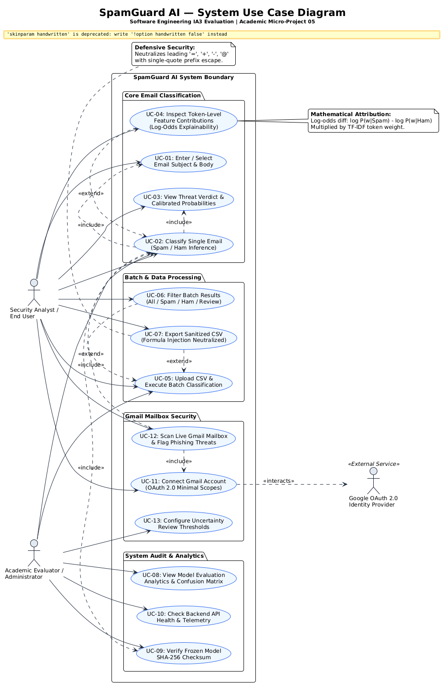
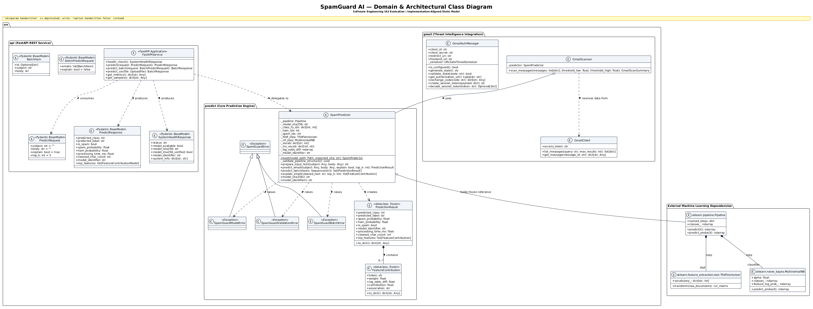
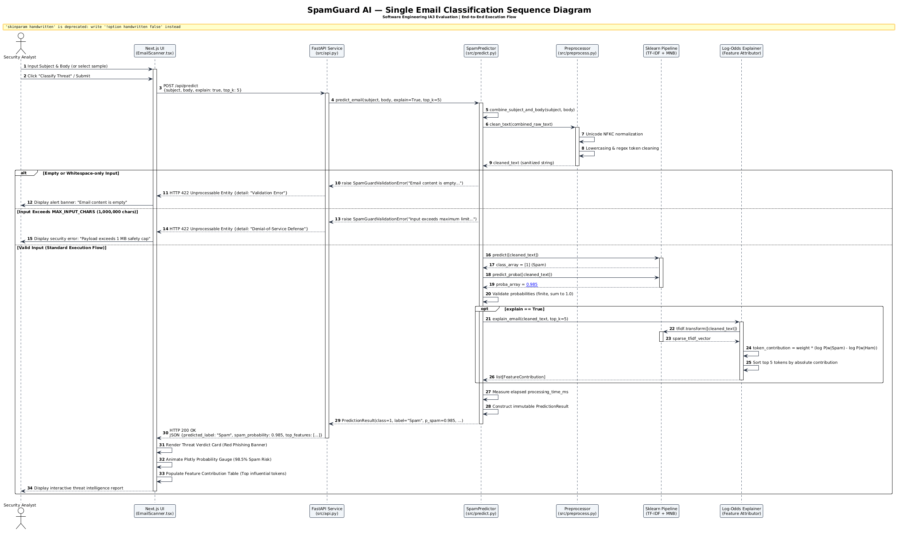
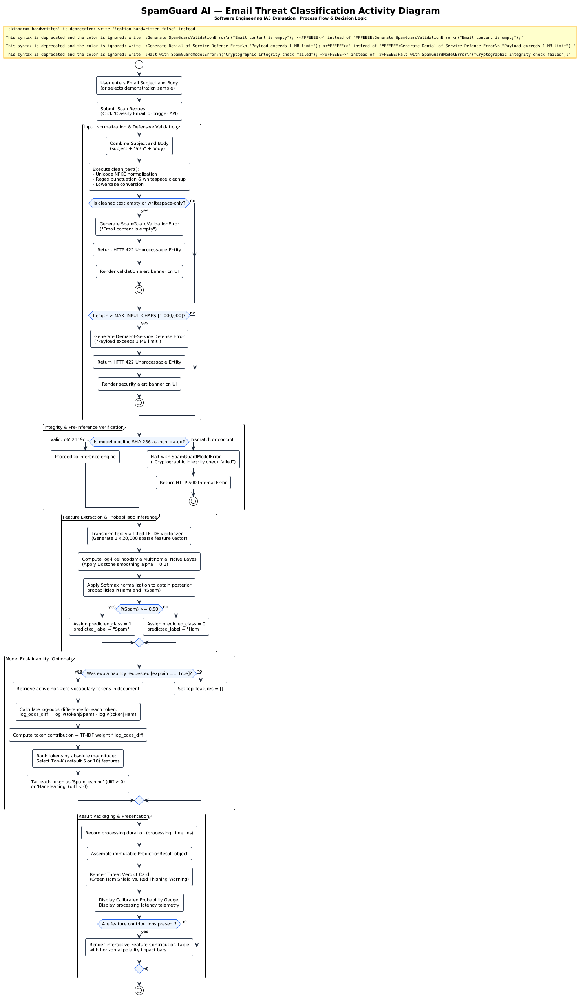
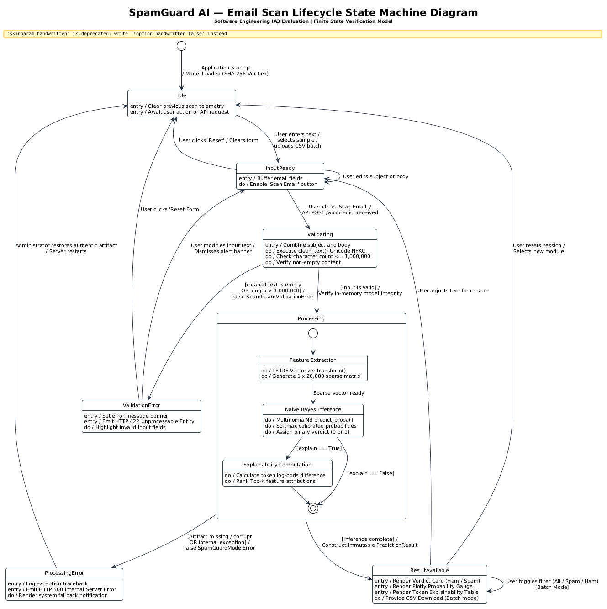

# Section 3: UML Diagrams — SpamGuard AI

**Evaluation:** Software Engineering Internal Assessment 3 (IA3)  
**Academic Micro-Project:** Micro Project – 05 (Semester 3)  
**System Name:** SpamGuard AI — AI-Based Spam Email Classifier  
**Document Classification:** Section 3 Compliance Artifact & Software Architecture Design  
**Release Date:** October 2026  
**Status:** 100% Implemented & UML Standard Compliant  

---

## Overview of Architectural UML Diagrams

In strict accordance with Section 3 of the IA3 Guidelines, exactly five standard UML diagrams have been developed to model the static structure, dynamic behavior, user interactions, and object lifecycles of SpamGuard AI:

1. **Use Case Diagram (`uml/01_use_case.puml`):** Models system actors, system boundary, and user capabilities with `<<include>>` and `<<extend>>` associations.
2. **Class Diagram (`uml/02_class_diagram.puml`):** Models core domain classes (`SpamPredictor`, `PredictionResult`, `FeatureContribution`), FastAPI Pydantic request/response schemas, exception hierarchies, and Scikit-learn pipeline bindings.
3. **Sequence Diagram (`uml/03_sequence_diagram.puml`):** Models the end-to-end runtime message exchange for a single-email classification across Next.js UI, FastAPI, Preprocessor, Scikit-learn Pipeline, and Log-Odds Explainer.
4. **Activity Diagram (`uml/04_activity_diagram.puml`):** Represents the end-to-end classification workflow, input normalization, boundary validation decision branches, model inference, and explainability extraction.
5. **State Machine Diagram (`uml/05_state_machine.puml`):** Models the finite state lifecycle of an email scan from `Idle` through `InputReady`, `Validating`, `Processing`, `ResultAvailable`, and defensive error states.

All source `.puml` files and rendered high-resolution `.png` and `.svg` files are located in [`docs/ia3/uml/`](file:///e:/Sem%203/AI/mp/SpamGuard-AI-Handoff/AI_mp/docs/ia3/uml).

---

## Diagram 1: System Use Case Diagram

- **Source File:** [`docs/ia3/uml/01_use_case.puml`](file:///e:/Sem%203/AI/mp/SpamGuard-AI-Handoff/AI_mp/docs/ia3/uml/01_use_case.puml)
- **Rendered Artifacts:** [`01_use_case.png`](file:///e:/Sem%203/AI/mp/SpamGuard-AI-Handoff/AI_mp/docs/ia3/uml/01_use_case.png) | [`01_use_case.svg`](file:///e:/Sem%203/AI/mp/SpamGuard-AI-Handoff/AI_mp/docs/ia3/uml/01_use_case.svg)
- **Description:** Illustrates the interactions between the primary human actors (**Security Analyst / End User**, **Academic Evaluator / Administrator**) and external systems (**Google OAuth 2.0 Identity Provider**) within the SpamGuard AI boundary. It captures core capabilities including single email classification, mathematical explainability, CSV batch classification, formula injection neutralization, model integrity audits, and live Gmail scanning.

---

## Diagram 2: Domain & Class Diagram

- **Source File:** [`docs/ia3/uml/02_class_diagram.puml`](file:///e:/Sem%203/AI/mp/SpamGuard-AI-Handoff/AI_mp/docs/ia3/uml/02_class_diagram.puml)
- **Rendered Artifacts:** [`02_class_diagram.png`](file:///e:/Sem%203/AI/mp/SpamGuard-AI-Handoff/AI_mp/docs/ia3/uml/02_class_diagram.png) | [`02_class_diagram.svg`](file:///e:/Sem%203/AI/mp/SpamGuard-AI-Handoff/AI_mp/docs/ia3/uml/02_class_diagram.svg)
- **Description:** Details the static structure of the codebase, reflecting the exact classes implemented in `src/predict.py`, `src/api.py`, and `src/gmail/`. Shows attribute types, method signatures, dataclass compositions (`PredictionResult` aggregates `FeatureContribution`), custom exception inheritance (`SpamGuardError` hierarchy), and external machine learning dependencies (`Pipeline`, `TfidfVectorizer`, `MultinomialNB`).

---

## Diagram 3: Single Email Classification Sequence Diagram

- **Source File:** [`docs/ia3/uml/03_sequence_diagram.puml`](file:///e:/Sem%203/AI/mp/SpamGuard-AI-Handoff/AI_mp/docs/ia3/uml/03_sequence_diagram.puml)
- **Rendered Artifacts:** [`03_sequence_diagram.png`](file:///e:/Sem%203/AI/mp/SpamGuard-AI-Handoff/AI_mp/docs/ia3/uml/03_sequence_diagram.png) | [`03_sequence_diagram.svg`](file:///e:/Sem%203/AI/mp/SpamGuard-AI-Handoff/AI_mp/docs/ia3/uml/03_sequence_diagram.svg)
- **Description:** Traces the chronological order of message execution during a single email scan: User $\to$ Next.js UI $\to$ FastAPI REST endpoint $\to$ `SpamPredictor` $\to$ `clean_text` normalization $\to$ Scikit-learn Pipeline $\to$ Log-Odds Explainer $\to$ UI Threat Rendering. It models both positive classification and alternative validation error paths (empty text and 1MB DoS violations).

---

## Diagram 4: Threat Classification Activity Diagram

- **Source File:** [`docs/ia3/uml/04_activity_diagram.puml`](file:///e:/Sem%203/AI/mp/SpamGuard-AI-Handoff/AI_mp/docs/ia3/uml/04_activity_diagram.puml)
- **Rendered Artifacts:** [`04_activity_diagram.png`](file:///e:/Sem%203/AI/mp/SpamGuard-AI-Handoff/AI_mp/docs/ia3/uml/04_activity_diagram.png) | [`04_activity_diagram.svg`](file:///e:/Sem%203/AI/mp/SpamGuard-AI-Handoff/AI_mp/docs/ia3/uml/04_activity_diagram.svg)
- **Description:** Visualizes the sequential workflow and control logic of text classification: text combination, Unicode NFKC normalization, empty checks, payload length bounding ($\le 1,000,000$ characters), cryptographic SHA-256 pre-inference gating, TF-IDF feature transformation, Naïve Bayes probability scoring, conditional log-odds explainability calculation, and UI result packaging.

---

## Diagram 5: Email Scan Lifecycle State Machine Diagram

- **Source File:** [`docs/ia3/uml/05_state_machine.puml`](file:///e:/Sem%203/AI/mp/SpamGuard-AI-Handoff/AI_mp/docs/ia3/uml/05_state_machine.puml)
- **Rendered Artifacts:** [`05_state_machine.png`](file:///e:/Sem%203/AI/mp/SpamGuard-AI-Handoff/AI_mp/docs/ia3/uml/05_state_machine.png) | [`05_state_machine.svg`](file:///e:/Sem%203/AI/mp/SpamGuard-AI-Handoff/AI_mp/docs/ia3/uml/05_state_machine.svg)
- **Description:** Models the discrete operational states of an email scan entity: `Idle` $\to$ `InputReady` $\to$ `Validating` $\to$ `Processing` (composite state with sub-states for Feature Extraction, Naïve Bayes Inference, and Explainability Computation) $\to$ `ResultAvailable`. It also models defensive failure states (`ValidationError`, `ProcessingError`) and state recovery transitions.

