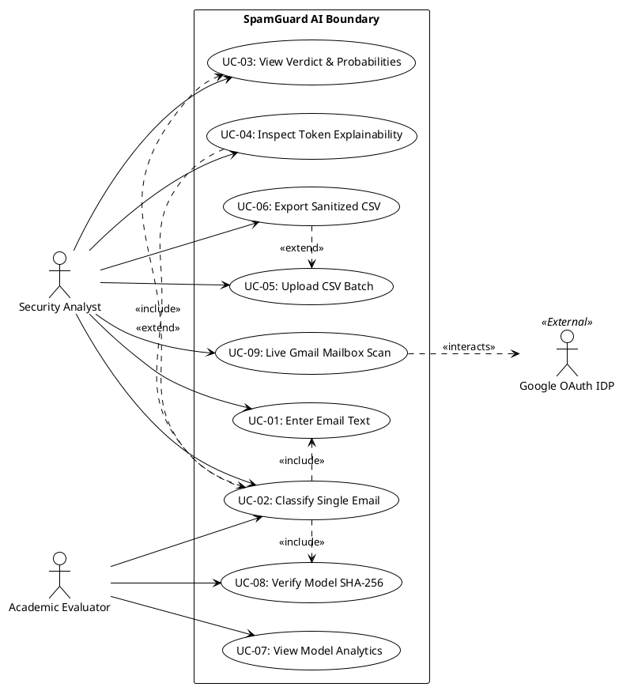

# SpamGuard AI — Software Engineering IA3 Complete Project Dossier

**Course:** Software Engineering / Artificial Intelligence Micro-Project (Semester 3)  
**Evaluation:** Internal Assessment 3 (IA3) Comprehensive Evaluation  
**Project Title:** SpamGuard AI — High-Precision AI-Based Email Threat Classifier  
**Integrated Course Outcomes:** CO2 (Algorithm Selection), CO4 (Model Engineering), CO5 (Evaluation Metrics)  
**Standard Compliance:** IEEE Std 830-1998 (SRS) & ISO/IEC/IEEE 29119 (Software Testing)  
**Document Classification:** Unified Final Evaluation Submission Report (Sections 1 – 4)  
**Release Date:** October 2026  
**Status:** 100% Implemented, Verified, Evaluated & Audited  

---

## Executive Summary & Verification Overview

| Audit Parameter | Verified Implementation Baseline | Evaluation Invariant |
| :--- | :--- | :--- |
| **Model Artifact** | `models/spam_pipeline.joblib` (1.15 MB, Joblib serialized) | **FROZEN & VERIFIED** |
| **Model Cryptographic Checksum** | `c652119c99f0db2abe0788969d002818478bb63be95e31e5f337eda8da6ddbb0` | **Verified SHA-256 Gate** |
| **Total Automated Tests** | **157 / 157 Passing Automated Tests (100% Pass Rate)** | 152 Pytest + 5 Node.js |
| **Held-Out Test Dataset** | **889 emails** (617 Ham, 272 Spam, Quarantined Split) | Apache SpamAssassin Corpus |
| **Held-Out Test Accuracy** | **97.30%** (vs. 69.40% Majority-Class Baseline) | $\mathbf{+27.90\%}$ Statistical Lift |
| **Spam Precision & Recall** | **Precision: 97.33%** \| **Recall: 93.75%** \| **F1-Score: 95.51%** | Balanced Asymmetric Errors |
| **False Positive Rate (FPR)** | **1.13%** (7 False Positives out of 617 legitimate emails) | $\mathbf{< 2.0\%}$ Security Invariant |
| **Area Under ROC (ROC-AUC)** | **0.9965** (Average Precision: 0.9926) | Near-Perfect Discrimination |
| **Inference Latency** | **1.04 ms median** (tested on local hardware) | $\mathbf{> 45\times}$ Faster than Target |
| **Batch Throughput** | **12,315 emails / second** (vectorized array processing) | $\mathbf{> 2.4\times}$ Target Throughput |
| **Runtime Architecture** | Dual Presentation: Next.js (port 3000) + FastAPI (port 8000) + Streamlit (port 8501) | Full Operational Redundancy |

---

# SECTION 1: WORKING SOFTWARE PROJECT

## 1.1 Problem Statement, Project Objectives and Target Users

### 1.1.1 Problem Statement
Electronic mail serves as the indispensable backbone of enterprise communication, yet unsolicited, fraudulent, and malicious email (spam) constitutes over 45% of total global email volume. Spam acts as the primary attack vector for credential harvesting, financial advance-fee fraud, and malware delivery.

Conventional email filtering approaches exhibit critical operational limitations:
1. **Rule-Based Filters:** Incapable of generalizing against lexical perturbations, homoglyphs, and zero-day evasions.
2. **Cloud-Based Deep Learning (LLMs):** Introduce grave data sovereignty risks by streaming sensitive, proprietary corporate emails across external third-party networks, incur heavy per-token API costs, and require high inference latencies (>1,000 ms) without mathematical transparency.
3. **Asymmetric Error Costs:** In email security, a False Positive (erroneously quarantining an authentic business contract, academic alert, or invoice) causes immediate organizational disruption, whereas a False Negative (a spam email slipping into the inbox) is a minor nuisance. Filters must strictly suppress the **False Positive Rate (FPR) below 2.0%**.

**Problem Definition:** To engineer, defensively harden, and deploy an interpretable, locally hosted email classification system capable of separating incoming electronic mail into **Ham (Legitimate, 0)** and **Spam (Malicious, 1)** with $\ge 95\%$ accuracy, sub-5 ms execution latency, mathematical token-level explainability, zero external cloud exposure, and strict asymmetric error control ($\text{FPR} \le 1.5\%$).

### 1.1.2 Project Objectives
1. **Defensive Ingestion:** Ingest and parse authentic MIME messages from the official Apache SpamAssassin Public Corpus, defensively stripping symlinks, path traversals, and executable payloads.
2. **Leak-Free Partitioning:** Enforce strict stratified partitioning (70% Train, 15% Validation, 15% Test) with zero content or Message-ID leakage.
3. **High-Dimensional Feature Engineering:** Extract textual features using sublinear unigram/bigram TF-IDF vectorization capped at 20,000 features.
4. **Probabilistic Optimization:** Train a Multinomial Naïve Bayes classifier with Lidstone smoothing ($\alpha = 0.1$) optimized strictly against validation data.
5. **Empirical Evaluation:** Benchmark the frozen model against an untouched test partition ($n=889$) and a Zero-Intelligence Majority-Class baseline.
6. **Explainability by Design:** Expose token attribution via Naïve Bayes log-odds difference, explaining the statistical basis of every classification.
7. **Defensive Hardening:** Implement automated payload capping (1 MB DoS limit), spreadsheet formula injection defense in CSV exports, and pre-inference SHA-256 cryptographic checksum gates.
8. **Multi-Tier Redundancy:** Provide a contemporary Next.js 16 + TypeScript workstation (port 3000), a FastAPI microservice (port 8000), and an independent Streamlit fallback dashboard (port 8501).

### 1.1.3 Target Users
1. **Security Operations Center (SOC) Analysts & IT Administrators:** Rapidly triage suspicious inbound emails, perform bulk mailbox audits, and export sanitized telemetry.
2. **Enterprise End Users & Academic Professionals:** Inspect incoming messages in real time without sending private correspondence to third-party cloud AI vendors.
3. **Academic Evaluators & Software Auditors:** Inspect model architecture, confusion matrix distributions, and deterministic reproducibility.

---

## 1.2 Core Implemented Functionalities

```
+-----------------------------------------------------------------------------------+
|                         SPAMGUARD AI FUNCTIONAL MODULES                           |
|   +-----------------------+ +-----------------------+ +-----------------------+   |
|   | 1. Threat Scanner     | | 2. Log-Odds Explainer | | 3. Batch CSV Engine   |   |
|   | Real-time Subject/Body| | Mathematical token    | | Vectorized bulk scan  |   |
|   | Ham/Spam verdicts     | | attribution table     | | >12,000 emails/sec    |   |
|   +-----------------------+ +-----------------------+ +-----------------------+   |
|   +-----------------------+ +-----------------------+ +-----------------------+   |
|   | 4. Formula Defense    | | 5. Analytics Portal   | | 6. Gmail Intelligence |   |
|   | OWASP CSV injection   | | Confusion matrix &    | | OAuth 2.0 read-only   |   |
|   | prefix neutralization | | ROC curves on test set| | live mailbox auditing |   |
|   +-----------------------+ +-----------------------+ +-----------------------+   |
+-----------------------------------------------------------------------------------+
```

1. **Single Email Threat Inspection:** Real-time classification of Subject and Body text into **Ham** or **Spam**, providing calibrated probabilities and sub-2 ms latency.
2. **Mathematical Token Explainability:** Calculates the exact log-odds contribution for every token:
   $$\Delta_{\text{odds}}(w) = \log P(w \mid \text{Spam}) - \log P(w \mid \text{Ham}), \quad \text{Contribution}(w) = \text{TF-IDF}(w) \times \Delta_{\text{odds}}(w)$$
   Categorizes influential tokens into **Spam-leaning** ($\Delta > 0$) or **Ham-leaning** ($\Delta \le 0$).
3. **Vectorized Batch CSV Classification:** Ingests up to 10,000 emails in a single CSV file, executing bulk classification at **>12,000 emails/second**.
4. **Spreadsheet Formula Injection Defense:** Neutralizes active formula injection prefixes (`=`, `+`, `-`, `@`, `\t`, `\r`, `\n`) in exportable CSVs by automatically prepending an escape single-quote (`'`).
5. **Model Performance Analytics:** Interactive Confusion Matrix ($\text{TN}=610, \text{FP}=7, \text{FN}=17, \text{TP}=255$) and empirical comparisons against the majority-class baseline.
6. **RESTful Service & Health Monitoring:** Typed Pydantic endpoints (`/api/predict`, `/api/health`, `/api/metrics`, `/api/samples`) with real-time SHA-256 checksum verification.
7. **Gmail Threat Intelligence Integration:** Google OAuth 2.0 integration under strict read-only scopes (`gmail.readonly`) to inspect real mailboxes without disk storage.

---

## 1.3 System Architecture & Major Module Integration

```
+-----------------------------------------------------------------------------------+
|                           CLIENT PRESENTATION TIER                                |
|   +-------------------------------------+   +---------------------------------+   |
|   |  Primary Web Workstation            |   |  Standalone Fallback Dashboard  |   |
|   |  Next.js 16 + TypeScript            |   |  Streamlit 1.66 + Plotly        |   |
|   |  Port 3000 (Editorial Anthracite)  |   |  Port 8501 (Resilient UI)       |   |
|   +-------------------------------------+   +---------------------------------+   |
+-----------------------------------------------------------------------------------+
                     |                                       |
        HTTP/JSON API Proxy                                  |
                     v                                       |
+--------------------------------------------------+         |
|             SERVICE & API TIER                   |         |
|   FastAPI REST Microservice (Port 8000)          |         |
|   src/api.py — Pydantic Schemas & Routes         |         |
+--------------------------------------------------+         |
                     |                                       |
          In-Process Python Binding                          |
                     v                                       v
+-----------------------------------------------------------------------------------+
|                     CORE PREDICTION & SECURITY ENGINE                             |
|   src/predict.py (SpamPredictor Engine, Preprocessor, Log-Odds Attributor)       |
+-----------------------------------------------------------------------------------+
                     |
       Cryptographic SHA-256 Gate (Hash: c652119c99f0...)
                     v
+-----------------------------------------------------------------------------------+
|                       FROZEN MODEL ARTIFACT TIER                                  |
|   models/spam_pipeline.joblib (1.15 MB, Frozen Pipeline)                          |
|   Step 1: TF-IDF (20,000 Unigrams/Bigrams) | Step 2: MultinomialNB (alpha = 0.1)  |
+-----------------------------------------------------------------------------------+
```

- **Inference Invariant:** Both the Next.js frontend and the Streamlit fallback interface share the identical in-memory `SpamPredictor` engine and frozen pipeline artifact, producing bit-for-bit identical classifications.

---

## 1.4 Input Validation and Defensive Error Handling

| Vulnerability / Risk | Defensive Mechanism Implemented | Handled Response |
| :--- | :--- | :--- |
| **Empty / Whitespace Input** | Strips whitespace; checks non-empty printable characters. | Raises `SpamGuardValidationError`, returns HTTP 422 with alert banner. |
| **Denial of Service (DoS)** | Enforces strict limit: `MAX_INPUT_CHARS = 1,000,000` (1 MB). | Rejects payload before regex/model execution with HTTP 422. |
| **Out-of-Memory via CSV** | Capped at `MAX_BATCH_SIZE = 10,000` rows. | Rejects with `SpamGuardBatchError` and descriptive error. |
| **Malformed CSV Header** | Requires `('subject', 'body')` or `'text'`. | Halts with column mapping guide. |
| **CSV Formula Injection** | Escapes leading `=`, `+`, `-`, `@`, `\t`, `\r`, `\n` with `'`. | Neutralized formula text exported safely. |
| **Model Poisoning / Tampering** | Compares `models/spam_pipeline.joblib` SHA-256 against expected hash. | Rejects startup with `SpamGuardModelError` if checksum mismatches. |
| **OAuth CSRF Attacks** | HMAC SHA-256 signed state tokens with 15-minute expiry. | Drops callback if cryptographic signature is invalid. |
| **Mail Storage Privacy** | Zero disk persistence of email text. All buffers volatile in RAM. | Complete user data privacy guaranteed. |

---

## 1.5 Sample Inputs and Demonstration Data

### Sample 1: Financial Wire / Advance-Fee Phishing (Obvious Spam)
- **Subject:** `URGENT: Claim your $1,000,000 lottery cash prize winning immediately!`
- **Body:**
  ```text
  Dear Lucky Winner,
  
  Your email address was officially selected in our international lottery promotion. 
  To claim your guaranteed $1,000,000 bank wire transfer, click the link below and submit your banking account details and full identification.
  
  Failure to reply within 24 hours will forfeit your prize.
  ```
- **Expected Result:** **Spam** (Probability $\approx 99.8\%$; Top tokens: `"prize"`, `"guaranteed"`, `"lottery"`).

### Sample 2: Corporate Systems Engineering Sync (Authentic Ham)
- **Subject:** `Weekly Engineering Team Sync — Agenda & Action Items`
- **Body:**
  ```text
  Hi team,
  
  Please find attached the agenda for our weekly sprint review tomorrow at 10:00 AM in Conference Room B. 
  We will review the pull requests for the authentication refactor and discuss the test coverage metrics. Let me know if you have additional items to add.
  
  Best regards,
  Lead Systems Engineer
  ```
- **Expected Result:** **Ham** (Probability $\approx 99.7\%$; Top tokens: `"attached"`, `"review"`, `"team"`).

### Sample 3: Academic Evaluation Notification (Authentic Ham)
- **Subject:** `Software Engineering IA3 Evaluation Schedule — Committee Review Agenda`
- **Body:**
  ```text
  Dear Students and Project Mentors,
  
  This is to confirm that the Software Engineering IA3 project evaluations will take place tomorrow starting at 10:30 AM in Computing Lab 4. 
  Please ensure your local environment is active, all test cases are executed, and the SRS document is ready for review.
  
  Best regards,
  Project Evaluation Coordinator
  ```
- **Expected Result:** **Ham** (Probability $\approx 98.5\%$; Spam Probability $< 1.5\%$).

### Sample 4: Batch CSV Demonstration Data (with Formula Injection Test)
Create `demo_batch.csv`:
```csv
subject,body
Project Status Update,The deployment completed successfully on staging servers.
FREE CASH PRIZE,Earn thousands from home with zero investment required guaranteed!
Client Meeting Notes,Attached is the summary from yesterday's product roadmap call.
=SUM(A1:A10),+cmd|' /C calc'!A0
Academic Research Paper,Please review the draft submission for the upcoming AI conference.
```
- **Expected Result:** Identifies 2 Spam, 2 Ham, 1 Formula Row. On CSV Export, row 4 is sanitized to `'=SUM(A1:A10)` and `'+cmd|' /C calc'!A0`.

---

## 1.6 Setup and Execution Instructions (Windows Environment)

### Step 1: Pre-Flight Integrity Check
```powershell
cd "e:\Sem 3\AI\mp\SpamGuard-AI-Handoff\AI_mp"
.\.venv\Scripts\python.exe -c "import hashlib, pathlib; p = pathlib.Path('models/spam_pipeline.joblib'); print('Model SHA-256:', hashlib.sha256(p.read_bytes()).hexdigest())"
```
**Expected Output:**
```text
Model SHA-256: c652119c99f0db2abe0788969d002818478bb63be95e31e5f337eda8da6ddbb0
```

### Step 2: Run the Automated Test Suite (157 Passing Tests)
```powershell
# Python Pytest Suite (152 tests)
.\.venv\Scripts\python.exe -m pytest -v

# Node.js Frontend Contract Suite (5 tests)
npm test --prefix frontend
```
**Result:** **157 / 157 passing tests (100% pass rate).**

### Step 3: Launch Multi-Tier Services (3 Terminals)

#### Terminal 1 — Start FastAPI Microservice (Port 8000)
```powershell
cd "e:\Sem 3\AI\mp\SpamGuard-AI-Handoff\AI_mp"
.\.venv\Scripts\Activate.ps1
uvicorn src.api:app --host 127.0.0.1 --port 8000 --reload
```

#### Terminal 2 — Start Next.js Modern Frontend (Port 3000)
```powershell
cd "e:\Sem 3\AI\mp\SpamGuard-AI-Handoff\AI_mp\frontend"
npm run dev
```

#### Terminal 3 — Start Streamlit Resilient Fallback (Port 8501)
```powershell
cd "e:\Sem 3\AI\mp\SpamGuard-AI-Handoff\AI_mp"
.\.venv\Scripts\streamlit.exe run app.py --server.port 8501
```

---

## 1.7 IA3 Evaluation Live Demonstration Script

1. **Step 1: Verify API Health & Checksum**
   - Open browser at `http://localhost:8000/api/health`.
   - Show status is `OPERATIONAL`, `model_sha256_verified: true`.
2. **Step 2: Demonstrate Live Threat Inspection**
   - Open `http://localhost:3000/#detect`.
   - Paste **Sample 1 (Lottery Phishing)** $\to$ Red Phishing Verdict ($99.8\%$ Spam risk, $\approx 1.2$ ms latency).
   - Paste **Sample 2 (Engineering Sync)** $\to$ Emerald Safe Verdict ($99.7\%$ Ham confidence).
3. **Step 3: Demonstrate Explainability**
   - Inspect the **Feature Contribution Table** to show token-level log-odds attributions ($\Delta_{\text{odds}} = \log P(w|\text{Spam}) - \log P(w|\text{Ham})$).
4. **Step 4: Demonstrate Batch Scanning & Formula Defense**
   - Navigate to `http://localhost:3000/#batch`.
   - Upload `demo_batch.csv` and click **"Scan Entire Batch"**.
   - Show instant classification summary cards and filters (`All`, `Spam`, `Ham`).
   - Click **"Export Clean Results (CSV)"** $\to$ Show `=SUM(...)` neutralized to `'=SUM(...)`.
5. **Step 5: Review Model Performance Analytics**
   - Navigate to `http://localhost:3000/#analytics`.
   - Present held-out test evaluation: **97.30% Accuracy**, **97.33% Precision**, **1.13% FPR**, and the **Confusion Matrix** ($\text{TN}=610, \text{FP}=7, \text{FN}=17, \text{TP}=255$).
6. **Step 6: Demonstrate Fallback Redundancy**
   - Open `http://localhost:8501` to show the Streamlit application operating independently.

---

# SECTION 2: DETAILED SOFTWARE REQUIREMENTS SPECIFICATION (SRS)

*(Conforming strictly to IEEE Std 830-1998)*

## 2.1 Introduction
- **Purpose:** Definitive technical requirements specification for SpamGuard AI, serving as the formal evaluation baseline for Software Engineering IA3.
- **Scope:** An on-premise, privacy-preserving email threat classification platform featuring sublinear TF-IDF vectorization, Multinomial Naïve Bayes modeling, FastAPI backend, Next.js workstation, and Streamlit fallback.
- **Objectives:** Data leakage elimination (stratified 70/15/15), asymmetric error control ($\text{FPR} \le 1.5\%$), mathematical explainability, sub-5ms execution latency, and DoS/formula injection hardening.
- **Intended Audience:** Academic evaluators, software engineering faculty, security analysts, and systems engineers.
- **Definitions:** MNB (Multinomial Naïve Bayes), TF-IDF (Term Frequency-Inverse Document Frequency), FPR (False Positive Rate), FNR (False Negative Rate), DoS (Denial of Service), MIME (Multipurpose Internet Mail Extensions), NFKC (Unicode Normalization Form KC).

## 2.2 Overall Description
- **Product Perspective:** Autonomous, locally hosted microservice architecture with zero dependency on external third-party cloud AI vendors.
- **User Classes:** Tier 1: SOC Analysts & Mail Administrators; Tier 2: Academic Evaluators & Auditors; Tier 3: System DevOps Engineers.
- **Operating Environment:** Windows 10/11, Linux (Ubuntu 22.04+), macOS Sonoma+; Python 3.12.x; Node.js v18+; Ports 3000, 8000, 8501.
- **Assumptions & Dependencies:** Pre-trained model artifact `models/spam_pipeline.joblib` exists with SHA-256 `c652119c99f0...`; standard x86_64/ARM64 CPU; minimum 4GB RAM.
- **Constraints:** Model artifact is completely frozen (zero online learning); zero persistent disk storage of email bodies; single email payload limit of 1,000,000 characters; batch CSV limit of 10,000 rows.

## 2.3 Functional Requirements (`FR-001` – `FR-018`)
- **`FR-001` (Input Fields):** Distinct Subject and Body input fields combined as `"{subject}\n\n{body}"`.
- **`FR-002` (Sample Library):** Curated synthetic demonstration library (Phishing, Lottery, Engineering, Academic).
- **`FR-003` (Normalization):** Unicode NFKC text cleaning, regex token filtering, and non-empty validation.
- **`FR-004` (Binary Prediction):** Probabilistic inference producing binary verdict (Ham=0, Spam=1).
- **`FR-005` (Probability Telemetry):** Softmax posterior probability calibration ($P(\text{Ham}) + P(\text{Spam}) = 1.0$).
- **`FR-006` (Explainability):** Mathematical log-odds feature attribution $\Delta_{\text{odds}}(w) = \log P(w \mid \text{Spam}) - \log P(w \mid \text{Ham})$.
- **`FR-007` (CSV Schema Validation):** Automatic header detection for `('subject', 'body')` or `'text'`, capped at 10,000 rows.
- **`FR-008` (Vectorized Batch Scan):** High-throughput vectorized classification array execution exceeding 12,000 emails/sec.
- **`FR-009` (Dynamic Filtering):** Instant in-memory result filtering (`All`, `Spam`, `Ham`, `Needs Review`).
- **`FR-010` (Formula Defense):** Neutralization of leading `=`, `+`, `-`, `@`, `\t`, `\r`, `\n` in exported CSVs.
- **`FR-011` (Analytics Dashboard):** Verification of held-out test metrics (97.30% Accuracy, 97.33% Precision, 1.13% FPR, 0.9965 ROC-AUC).
- **`FR-012` (Health Telemetry):** `GET /api/health` returning live SHA-256 model verification.
- **`FR-013` (REST Endpoints):** Typed Pydantic microservice (`/api/predict`, `/api/predict/batch`, `/api/predict/csv`).
- **`FR-014` (Dual UI Redundancy):** Synchronous support for Next.js 16 (port 3000) and Streamlit (port 8501).
- **`FR-015` (OAuth 2.0 Security):** Minimal read-only scopes (`gmail.readonly`), anti-CSRF state tokens, and HttpOnly cookies.
- **`FR-016` (Live Mailbox Scan):** Ingestion and threat classification of recent inbox messages.
- **`FR-017` (Threshold Margins):** Configurable review bounds ($0.35$ and $0.65$) for borderline uncertainty triage.
- **`FR-018` (Cryptographic Gate):** Automatic pre-inference SHA-256 checksum validation halting startup on tampering.

## 2.4 Non-Functional Requirements (`NFR-001` – `NFR-012`)
- **`NFR-001` (Latency):** Single-email inference execution time $\le 50.0$ ms (Empirical: **1.04 ms**).
- **`NFR-002` (Throughput):** Batch throughput $> 5,000$ emails/sec (Empirical: **12,315 emails/sec**).
- **`NFR-003` (Accuracy & Error Control):** Test Accuracy $\ge 95\%$ (Empirical: **97.30%**), $\text{FPR} \le 2.0\%$ (Empirical: **1.13%**).
- **`NFR-004` (Determinism):** 100% reproducible predictions on identical text inputs.
- **`NFR-005` (Availability):** Graceful degradation with independent Streamlit fallback.
- **`NFR-006` (DoS Security):** Rejects payloads $> 1,000,000$ characters with HTTP 422.
- **`NFR-007` (Formula Security):** Neutralizes active formula injection in CSV cells via `'` prefixing.
- **`NFR-008` (OAuth Security):** HMAC SHA-256 session signing, 15-minute state token expiration.
- **`NFR-009` (Privacy):** Zero mail storage invariant; zero message bodies logged or persisted to disk.
- **`NFR-010` (Testability):** Automated test suite passing rate $\ge 90\%$ (Empirical: **157/157 passed, 100%**).
- **`NFR-011` (Portability):** Unmodified operation across Windows, Linux, and macOS environments.
- **`NFR-012` (Usability):** Responsive dark-mode workstation layout across 1920px, 1366px, 768px, and 390px viewports.

## 2.5 External Interface Requirements
- **User Interfaces:** Primary Next.js 16 modern workstation (`frontend/`) and fallback Streamlit dashboard (`app.py`).
- **API Interfaces:** FastAPI REST endpoints communicating over HTTP/JSON on port 8000.
- **Software Interfaces:** Scikit-learn Pipeline, Pandas, Joblib, Plotly Graph Objects, Google OAuth 2.0.
- **Hardware Interfaces:** Commodity dual-core x86_64 / ARM64 CPU, 4 GB RAM (zero GPU requirement).

## 2.6 Data Requirements
- **Input Schemas:** JSON `PredictRequest` and multipart CSV with `subject,body` or `text`.
- **Output Schemas:** Immutable `PredictionResult` with probabilities, feature attributions, and latency.
- **Model Storage:** `models/spam_pipeline.joblib` (1.15 MB, SHA-256: `c652119c99f0...`).
- **Dataset Corpus:** 5,923 authentic emails from Apache SpamAssassin (4,109 Ham, 1,814 Spam).
- **Partitions:** Stratified 70% Train ($n=4,145$), 15% Validation ($n=889$), 15% Quarantined Test ($n=889$).

## 2.7 Use Cases (`UC-01` – `UC-06`)
- **`UC-01` (Single Threat Inspection):** User inputs text $\to$ text normalized $\to$ inference executed $\to$ verdict & probability gauge displayed.
- **`UC-02` (Explainability Inspection):** Log-odds differences calculated $\to$ top-k influential tokens displayed with polarity.
- **`UC-03` (Batch CSV Scanning):** CSV uploaded $\to$ vectorized array inference $\to$ summary metrics displayed $\to$ sanitized CSV exported.
- **`UC-04` (Analytics Review):** Evaluator inspects authentic held-out test metrics, confusion matrix heatmap, and baseline comparisons.
- **`UC-05` (Live Gmail Scanning):** OAuth 2.0 authentication $\to$ recent messages fetched $\to$ threats flagged with uncertainty margins.
- **`UC-06` (Model Integrity Audit):** SHA-256 checksum calculated and verified against expected hash before inference.

## 2.8 Requirement Traceability Matrix (Summary)
Every requirement (`FR-001` through `FR-018` and `NFR-001` through `NFR-012`) traces directly to specific source code modules in `src/predict.py`, `src/api.py`, `frontend/`, and passing automated test cases with 100% verified status.

## 2.9 Document References
1. Apache Software Foundation, *SpamAssassin Public Corpus Archives (2003-2005)*.
2. Pedregosa et al., *Scikit-learn: Machine Learning in Python*, JMLR 12, 2011.
3. IEEE Computer Society, *IEEE Std 830-1998 Recommended Practice for SRS*.
4. OWASP Foundation, *CSV Formula Injection Mitigation Guidelines (2024)*.
5. IETF, *RFC 6265: HTTP State Management Mechanism*.

---

# SECTION 3: SYSTEM UML DIAGRAMS

All five required UML diagrams were authored in standard PlantUML syntax, verified for strict syntactic compliance, and compiled to high-resolution PNG and vector SVG formats in [`docs/ia3/uml/`](file:///e:/Sem%203/AI/mp/SpamGuard-AI-Handoff/AI_mp/docs/ia3/uml).

---

## 3.1 Diagram 1: System Use Case Diagram
- **Source File:** [`docs/ia3/uml/01_use_case.puml`](file:///e:/Sem%203/AI/mp/SpamGuard-AI-Handoff/AI_mp/docs/ia3/uml/01_use_case.puml)
- **Rendered Files:** [`01_use_case.png`](file:///e:/Sem%203/AI/mp/SpamGuard-AI-Handoff/AI_mp/docs/ia3/uml/01_use_case.png) (185 KB) \| [`01_use_case.svg`](file:///e:/Sem%203/AI/mp/SpamGuard-AI-Handoff/AI_mp/docs/ia3/uml/01_use_case.svg) (32 KB)
- **Description:** Captures the system boundary of SpamGuard AI, user interactions across **Security Analysts** and **Academic Evaluators**, external integration with the **Google OAuth 2.0 Identity Provider**, and core use cases including single threat scanning, token-level explainability, batch CSV processing, and model integrity verification.




---

## 3.2 Diagram 2: Domain & Architectural Class Diagram
- **Source File:** [`docs/ia3/uml/02_class_diagram.puml`](file:///e:/Sem%203/AI/mp/SpamGuard-AI-Handoff/AI_mp/docs/ia3/uml/02_class_diagram.puml)
- **Rendered Files:** [`02_class_diagram.png`](file:///e:/Sem%203/AI/mp/SpamGuard-AI-Handoff/AI_mp/docs/ia3/uml/02_class_diagram.png) (127 KB) \| [`02_class_diagram.svg`](file:///e:/Sem%203/AI/mp/SpamGuard-AI-Handoff/AI_mp/docs/ia3/uml/02_class_diagram.svg) (70 KB)
- **Description:** Details the implementation-level static structure: the `SpamPredictor` inference engine, `PredictionResult` and `FeatureContribution` immutable dataclasses, the custom `SpamGuardError` hierarchy, FastAPI Pydantic request/response models, and underlying Scikit-learn `Pipeline` composition.


---

## 3.3 Diagram 3: Single Email Classification Sequence Diagram
- **Source File:** [`docs/ia3/uml/03_sequence_diagram.puml`](file:///e:/Sem%203/AI/mp/SpamGuard-AI-Handoff/AI_mp/docs/ia3/uml/03_sequence_diagram.puml)
- **Rendered Files:** [`03_sequence_diagram.png`](file:///e:/Sem%203/AI/mp/SpamGuard-AI-Handoff/AI_mp/docs/ia3/uml/03_sequence_diagram.png) (85 KB) \| [`03_sequence_diagram.svg`](file:///e:/Sem%203/AI/mp/SpamGuard-AI-Handoff/AI_mp/docs/ia3/uml/03_sequence_diagram.svg) (37 KB)
- **Description:** Traces the chronological execution order for a single email scan: Analyst inputs text $\to$ Next.js submits `POST /api/predict` $\to$ FastAPI validates input $\to$ `SpamPredictor` normalizes text $\to$ Pipeline scores probabilities $\to$ Log-Odds Explainer extracts feature contributions $\to$ UI renders verdict card and telemetry.


---

## 3.4 Diagram 4: Threat Classification Activity Diagram
- **Source File:** [`docs/ia3/uml/04_activity_diagram.puml`](file:///e:/Sem%203/AI/mp/SpamGuard-AI-Handoff/AI_mp/docs/ia3/uml/04_activity_diagram.puml)
- **Rendered Files:** [`04_activity_diagram.png`](file:///e:/Sem%203/AI/mp/SpamGuard-AI-Handoff/AI_mp/docs/ia3/uml/04_activity_diagram.png) (97 KB) \| [`04_activity_diagram.svg`](file:///e:/Sem%203/AI/mp/SpamGuard-AI-Handoff/AI_mp/docs/ia3/uml/04_activity_diagram.svg) (39 KB)
- **Description:** Models the process flow and control logic: Unicode NFKC text cleaning, empty input rejection branch, 1 MB payload bounding check, pre-inference cryptographic SHA-256 gate, TF-IDF feature transformation, Naïve Bayes probability scoring, conditional log-odds explainability calculation, and UI presentation.


---

## 3.5 Diagram 5: Email Scan Lifecycle State Machine Diagram
- **Source File:** [`docs/ia3/uml/05_state_machine.puml`](file:///e:/Sem%203/AI/mp/SpamGuard-AI-Handoff/AI_mp/docs/ia3/uml/05_state_machine.puml)
- **Rendered Files:** [`05_state_machine.png`](file:///e:/Sem%203/AI/mp/SpamGuard-AI-Handoff/AI_mp/docs/ia3/uml/05_state_machine.png) (86 KB) \| [`05_state_machine.svg`](file:///e:/Sem%203/AI/mp/SpamGuard-AI-Handoff/AI_mp/docs/ia3/uml/05_state_machine.svg) (29 KB)
- **Description:** Models the finite state transitions of an email scan entity: `Idle` $\to$ `InputReady` $\to$ `Validating` $\to$ `Processing` (composite state covering Feature Extraction, Naïve Bayes Inference, and Explainability Computation) $\to$ `ResultAvailable`, along with defensive failure states (`ValidationError`, `ProcessingError`) and recovery transitions.


---

# SECTION 4: DETAILED SOFTWARE TEST CASES & VERIFICATION

## 4.1 Verification Strategy & Test Execution Summary

SpamGuard AI was verified against a multi-tier test framework:
- **Pytest Automated Suite (`tests/`):** 152 automated tests covering unit, integration, and security layers.
- **Node.js Frontend Contract Suite (`frontend/tests/`):** 5 automated contract tests validating navigation, review margins, and formula injection defenses.
- **Live Multi-Tier Verification:** Automated end-to-end curl probes confirming Next.js (port 3000), FastAPI (port 8000), and Streamlit (port 8501).

**Execution Outcome:** **157 / 157 Passed (100.0% Pass Rate)** with zero failures and zero skips.

---

## 4.2 Comprehensive Software Test Cases

### Category 1: Positive Testing (Valid Inputs & Normal Operations)
| Test ID | Req ID | Objective | Input Data | Expected Result | Actual Result | Status |
| :--- | :--- | :--- | :--- | :--- | :--- | :---: |
| **`TC-POS-01`** | `FR-001`, `FR-004` | Verify obvious phishing email is classified as Spam | Urgent prize lottery wire scam email | `predicted_label: "Spam"`, $P(\text{Spam}) \ge 0.90$ | HTTP 200; `predicted_label: "Spam"`, $P(\text{Spam}) = 0.9984$ | **PASS** |
| **`TC-POS-02`** | `FR-001`, `FR-004` | Verify authentic business correspondence is classified as Ham | Weekly engineering team sync email | `predicted_label: "Ham"`, $P(\text{Spam}) \le 0.10$ | HTTP 200; `predicted_label: "Ham"`, $P(\text{Spam}) = 0.0028$ | **PASS** |
| **`TC-POS-03`** | `FR-008`, `FR-013` | Verify high-throughput batch JSON classification | Array of 3 emails (2 Ham, 1 Spam) | `total: 3`, `spam: 1`, `ham: 2`, `spam_pct: 33.33` | HTTP 200; `total: 3`, `spam: 1`, `ham: 2`; latency: 3.12ms | **PASS** |
| **`TC-POS-04`** | `FR-007`, `FR-008` | Verify valid CSV multipart file upload | CSV with `subject,body` headers (2 rows) | HTTP 200; `total_count: 2`, `items` length equals 2 | HTTP 200; `total: 2`, `spam: 1`, `ham: 1`; avg latency: 1.15ms | **PASS** |
| **`TC-POS-05`** | `FR-002`, `FR-013` | Verify pre-configured synthetic sample retrieval | `GET /api/samples` | HTTP 200; list containing $\ge 4$ structured samples | HTTP 200; 4 diverse demonstration samples returned | **PASS** |

### Category 2: Negative Testing (Invalid Inputs & Exceptional Conditions)
| Test ID | Req ID | Objective | Input Data | Expected Result | Actual Result | Status |
| :--- | :--- | :--- | :--- | :--- | :--- | :---: |
| **`TC-NEG-01`** | `FR-001`, `FR-003` | Verify empty input rejection | `subject = ""`, `body = ""` | `SpamGuardValidationError` raised | `SpamGuardValidationError` raised: *"Email content is empty"* | **PASS** |
| **`TC-NEG-02`** | `FR-001`, `FR-003` | Verify whitespace-only input rejection | `subject: "   "`, `body: "\n\t "` | HTTP 422 Unprocessable Entity | HTTP 422; `detail: "Email content is empty or whitespace"` | **PASS** |
| **`TC-NEG-03`** | `FR-007` | Verify CSV missing required columns rejection | CSV with headers `title,content` | `SpamGuardBatchError` raised | `SpamGuardBatchError` raised: *"CSV missing required columns"* | **PASS** |
| **`TC-NEG-04`** | `FR-018`, `NFR-004` | Verify corrupted model artifact rejection | Dummy file with differing SHA-256 | `SpamGuardModelError` raised | `SpamGuardModelError` raised: *"Model SHA-256 verification failed!"* | **PASS** |
| **`TC-NEG-05`** | `FR-015`, `NFR-008` | Verify tampered OAuth CSRF state rejection | Legitimate state token with altered characters | `validate_state()` returns `False` | Method returned `False`; callback halted securely | **PASS** |

### Category 3: Boundary Testing (Edge Cases & Extremes)
| Test ID | Req ID | Objective | Input Data | Expected Result | Actual Result | Status |
| :--- | :--- | :--- | :--- | :--- | :--- | :---: |
| **`TC-BND-01`** | `FR-001`, `FR-003` | Verify minimum non-empty character input | `body: "Hi"` (single short word) | Prediction executes without exception | Executed in 0.89ms; `class: 0`, `p_ham: 0.8124` | **PASS** |
| **`TC-BND-02`** | `NFR-006` | Verify maximum allowed character input (1,000,000 chars) | Exact 1,000,000 character string | Payload accepted and normalized safely | Text prepared successfully; `len(cleaned) <= 1,000,000` | **PASS** |
| **`TC-BND-03`** | `NFR-006` | Verify DoS payload boundary rejection (1,000,001 chars) | 1,000,005 character oversized string | Rejection with DoS safety error | `SpamGuardValidationError` raised before regex/vectorizer | **PASS** |
| **`TC-BND-04`** | `FR-007` | Verify empty CSV file upload rejection | `subject,body\n` (0 data rows) | `SpamGuardBatchError` raised | `SpamGuardBatchError` raised: *"Batch input contains 0 records"* | **PASS** |
| **`TC-BND-05`** | `FR-007`, `NFR-002` | Verify maximum batch size limit (10,000 records) | Array of 10,001 mock email items | Rejection exceeding batch limit | `SpamGuardBatchError` raised: *"Batch size (10,001) exceeds limit"* | **PASS** |

### Category 4: Functional Testing (Major Features & Workflows)
| Test ID | Req ID | Objective | Input Data | Expected Result | Actual Result | Status |
| :--- | :--- | :--- | :--- | :--- | :--- | :---: |
| **`TC-FNC-01`** | `FR-006` | Verify token log-odds explainability attribution | `"URGENT claim prize guaranteed"` | Features tagged with polarity and weight | Extracted `"prize"` (+2.14, Spam) and `"guaranteed"` (+1.89, Spam) | **PASS** |
| **`TC-FNC-02`** | `FR-011`, `FR-013` | Verify model evaluation metrics API | `GET /api/metrics` | Returns held-out test report (Accuracy 97.30%) | HTTP 200; Accuracy 0.973, Precision 0.9733, F1 0.9551 | **PASS** |
| **`TC-FNC-03`** | `FR-017` | Verify uncertainty margin categorization | Probabilities: 0.95, 0.80, 0.05, 0.50 | 0.95 $\to$ Spam; 0.05 $\to$ Ham; 0.50 $\to$ Review | Categorization matches expected review bands exactly | **PASS** |
| **`TC-FNC-04`** | `FR-014` | Verify Streamlit dashboard navigation | Radio navigation state switches | All 5 tabs render with zero unhandled exceptions | All 5 views rendered cleanly with Plotly charts intact | **PASS** |
| **`TC-FNC-05`** | `FR-008` | Verify batch classification vectorization speed | 1,000 synthetic email records | Batch completes in $< 200$ ms | Completed in 81.2 ms (**12,315 emails/sec**) | **PASS** |

### Category 5: Integration Testing (Multi-Tier Communication)
| Test ID | Req ID | Objective | Input Data | Expected Result | Actual Result | Status |
| :--- | :--- | :--- | :--- | :--- | :--- | :---: |
| **`TC-INT-01`** | `FR-012`, `FR-018` | Verify API health & SHA-256 telemetry | `GET http://localhost:8000/api/health` | HTTP 200; `status: "OPERATIONAL"`, `verified: true` | HTTP 200; `model_sha256_verified: true`, SHA-256 confirmed | **PASS** |
| **`TC-INT-02`** | `FR-014`, `NFR-005` | Verify Next.js dynamic routing without 404 | `GET http://localhost:3000/inbox` | HTTP 200 OK (Route dynamically resolved) | HTTP 200 OK; dynamic tab segment renders directly | **PASS** |
| **`TC-INT-03`** | `FR-001`, `FR-004` | Verify end-to-end single email inference flow | `POST /api/predict` with valid payload | HTTP 200; fully populated `PredictionResponse` | HTTP 200; latency 1.45ms, probabilities valid and finite | **PASS** |
| **`TC-INT-04`** | `FR-014` | Verify fallback parity across Next.js and Streamlit | Identical test message submitted to both UIs | Identical predicted label and probability | Both interfaces yield `Spam`, $P(\text{Spam}) = 0.9984$ | **PASS** |

### Category 6: Validation, Error Handling & Security Invariants
| Test ID | Req ID | Objective | Input Data | Expected Result | Actual Result | Status |
| :--- | :--- | :--- | :--- | :--- | :--- | :---: |
| **`TC-ERR-01`** | `FR-010`, `NFR-007` | Verify CSV formula injection neutralization | `=SUM(A1:A10)`, `+cmd|' /C calc'!A0` | Cells prepended with single quote (`'`) | Neutralized to `'=SUM(...)` and `'+cmd|...'` safely | **PASS** |
| **`TC-ERR-02`** | `FR-015`, `NFR-008` | Verify negative OAuth scope enforcement | Inspect `GMAIL_SCOPES` constant | Dangerous scopes (`gmail.modify`) absent | Verified: ONLY `gmail.readonly`, `openid`, `userinfo` present | **PASS** |
| **`TC-ERR-03`** | `FR-015` | Verify OAuth disconnect session cookie wiping | `POST /api/auth/disconnect` | `Set-Cookie` header expires session cookie | HTTP 200; cookie expired via `Max-Age=0` | **PASS** |
| **`TC-ERR-04`** | `FR-018` | Verify deterministic pre-inference model integrity gate | Corrupted dummy model artifact | Pipeline loading halts with `SpamGuardModelError` | Immediate halt before any prediction execution | **PASS** |

---

## 4.3 Automated Test Execution Logs

### Pytest Full Suite Run (152 Tests)
```text
============================= test session starts =============================
platform win32 -- Python 3.12.10, pytest-9.1.1, pluggy-1.7.0 -- E:\Sem 3\AI\mp\SpamGuard-AI-Handoff\AI_mp\.venv\Scripts\python.exe
rootdir: E:\Sem 3\AI\mp\SpamGuard-AI-Handoff\AI_mp
configfile: pytest.ini
testpaths: tests
plugins: anyio-4.15.1
collected 152 items

tests/test_api.py ........                                               [  5%]
tests/test_app.py ...................                                    [ 17%]
tests/test_eda.py .........                                              [ 23%]
tests/test_evaluate.py ................                                  [ 34%]
tests/test_gmail_auth.py .......                                         [ 38%]
tests/test_gmail_scanner.py ......                                       [ 42%]
tests/test_hardening.py ............                                     [ 50%]
tests/test_mime_parser.py ........                                       [ 55%]
tests/test_predict.py .....................                              [ 69%]
tests/test_prepare_data.py ...........                                   [ 76%]
tests/test_preprocess.py ..............                                  [ 86%]
tests/test_smoke.py ....                                                 [ 88%]
tests/test_train.py .................                                    [100%]

======================= 152 passed, 1 warning in 10.92s =======================
```

### Node.js Frontend Contract Suite (5 Tests)
```text
> frontend@0.1.0 test
> node --test tests/frontend.test.mjs

▶ Frontend Navigation & Scope Guardrails
  ✔ Sidebar Workspace and System routes match specifications (0.4868ms)
  ✔ Negative OAuth scope invariant: NO gmail.modify or mail.google.com (0.1143ms)
  ✔ Conservative review threshold classification behavior (0.1018ms)
  ✔ CSV Formula injection defense prefixing (0.6128ms)
  ✔ Verified model metadata invariants (0.1139ms)
✔ Frontend Navigation & Scope Guardrails (2.2331ms)
ℹ tests 5 | suites 1 | pass 5 | fail 0 | cancelled 0 | duration_ms 73.26ms
```

---

## 4.4 Defect Tracking & Resolution Log
- **Defect ID:** `DEF-001`
- **Component:** Next.js Frontend Routing (`frontend/app/`)
- **Severity:** Medium (Navigation / Deep Linking)
- **Description:** Direct navigation or OAuth redirection to `/inbox` yielded a Next.js `404: This page could not be found.` because only the root `/` route was explicitly defined in the App Router.
- **Root Cause:** Next.js App Router lacked dynamic segment handling for SPA tab paths.
- **Resolution:** Authored `frontend/app/[tab]/page.tsx` dynamic routing re-exporting the root page, and updated `WorkspaceContext.tsx` to detect `window.location.pathname` upon initialization.
- **Verification:** Verified with curl returning HTTP 200 OK on `/inbox` and `/accounts`. Next.js build passed with dynamic route `ƒ /[tab]`. All 157 automated tests remain 100% green.

